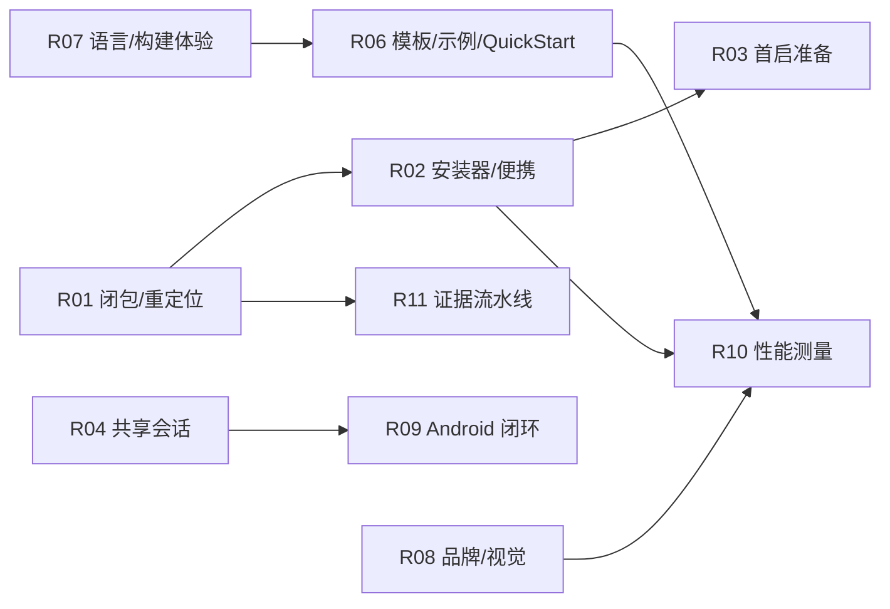

# release 0.0.1 Part 2 实施方案

状态：待 review（D1–D7 已由用户于 2026-10-23 裁定并写入[设计方案第 19 节](2026-10-22-meditor-project-design.md)，本文已按裁定更新）。本文是接手 PR #1 之后的实施计划，不是验收结论；第 10 节产品级门禁不变，本文不建立第二套发布标准。

## 1. 基线与可复用资产

基线：PR #1 head `ed3ccdb`（`release-0.0.1`），CI 6/6 绿，`tests/acceptance.json` 记录 0/52 平台准则通过。

已交付、Part 2 直接复用的资产：

- 内核与工作台：文档事务/undo/并发保存/32 MiB 边界、只读与写失败保护、异步 LSP（后台查询/诊断/定义引用/UTF-16↔UTF-8 映射）、查找替换、C++/Markdown/JSON/TOML 词法高亮、工作区切换生命周期、任务输出与进度、en/zh 各 150 条 i18n、About 与离线许可证、快捷键模块。
- 测试基座：17 个应用测试二进制、CLI 契约与真实后端 fixture、headless 视图树/虚拟时钟、Linux Xvfb 原生 GUI 8 场景、独立消费者与 packed 接口验证。
- 分发脚手架：`packaging/tools.json` 按 SHA-256 固定四桌面目标的 mcpp 2026.10.21.1 / mcppls 0.0.16 载荷；`prepare_payloads.py`、`prepare_candidate.py`（提交树导出 + 私有路径重映射 + receipt）、`check_artifact_privacy.py`（机器身份/构建路径/越界符号链接扫描）、`check_acceptance.py --release`（52 项发布门禁）。

## 2. 差距根因分类（0/52 的原因）

| 类 | 根因（证据） | 直接阻塞 |
| --- | --- | --- |
| A. 运行时闭包缺陷 | Linux release 候选：staged CLI 保留 loader/RPATH，捆绑库与上游预构建二进制含构建机路径；含空格的 mcpp tool home 在 Linux/macOS 失败（`packaging/README.md` 记录，候选全部被拒） | A01/A10/A11 桌面全部；便携模式 §16 |
| B. 无安装产物 | 四端均无可交付安装产物：Windows/Linux 无便携归档与安装器，macOS 无可执行归档/xlings 分发（0.0.1 不做签名公证，第 19 节 D1），Android 仅本地未签名探针 APK | A01/A11 |
| C. 工具宿主与真机闭环缺失 | Android 工具宿主策略未实现（§10.3 要求 Termux/PRoot 类方案经 GUI/CLI 操作）；ADB 触摸注入被系统拒绝，IME/触摸/开发闭环零证据 | A02/A04/A12(Android) |
| D. 功能缺口 | GUI/CLI 共享会话、未保存恢复、补全/hover、semantic tokens 分层、文件监视、导航历史、只读 SDK 源码、两个项目模板、mcpp/xlings/mcppls 源码归档、Quick Start、依赖图/import 图、品牌标识、target/缓存/进度面板、可配置键位、剩余语言高亮 | A02/A04/A05/A07/A08/A12 |
| E. 测量与证据未填 | §10.4 性能预算零实测（方案自记“目前没有实测证明”）；两小时可靠性未跑；acceptance.json 六字段证据（commit/artifactSha256/environment/procedure/result/reference）全部为空 | 全部 52 项 |

## 3. 目标与非目标

目标：把 release-0.0.1 从工程基座推进到四端发布候选并填充验收证据，使 `check_acceptance.py --release` 逐项可判；产品标准为开箱即用、对 mcpp 与 C++ Modules 的功能丰富度超过 mcpp-vscode（第 19 节 D5/D6）；工作继续在 PR #1 上增量提交、不 squash（§10.5、第 19 节 D7）。
依赖原则（第 19 节 D9）：新增库走 mcpp-index、工具走 xim-pkgindex，缺包按索引规范向上游提交，不手工 vendor 或本机预装绕过。

非目标：不放宽第 10 节门禁；未测/阻塞不记为通过；iOS/Web 维持探索标记；不修改 mcpp/mcppls 源码；不把 CI 绿灯当产品验收。隐私门禁只作用于发行产物与仓库内容（构建机路径/机器身份不入包、文档与提交脱敏）；编辑器运行时对用户文件按通用编辑器（VS Code 类）标准处理，不做额外内容扫描或性能开销（2026-10-23 用户裁定）。

## 4. 工作流分解

| ID | 名称 | 主要交付 | 对应验收 | 前置 |
| --- | --- | --- | --- | --- |
| R01 | 运行时闭包与重定位修复 | 候选可脱离构建机路径运行；空格/中文路径通过 | A01/A10 前置 | — |
| R02 | 安装器与便携模式 | 四端实际安装产物 + portable.json 契约 + 升级/回滚/卸载 | A01/A11 | R01 |
| R03 | 首启环境准备引导 | meditor 引导工具链准备：进度/取消/重试/离线分支 | A01 | R02 |
| R04 | GUI/CLI 共享会话 | 跨进程共享未保存文档、revision 冲突无部分修改 | A05 | — |
| R05 | 恢复与日用可靠性 | 未保存恢复 ≤5s 损失窗口、≥20 次强杀循环、2 小时 soak | A03/A07 | — |
| R06 | 模板、示例与 Quick Start | Hello World/ImGui 模板、三个源码归档、Quick Start 基础+进阶、依赖/import 图 | A12 + §6.4/§17/P05-06 | R07(部分) |
| R07 | 语言与构建体验补齐 | 补全/hover/签名帮助、semantic tokens 分层、文件监视、导航历史、SDK 只读源码、target/缓存/进度面板、可配置键位 | A02/A06/A08 | — |
| R08 | 品牌与视觉终审 | me/mc++ 标识主资产、四端图标/README/安装器资源、视觉检查清单 | A08 + P02/P07 | 标识决策可先行 |
| R09 | Android 产品闭环 | 工具宿主方案落地（模拟器先行）、SAF/外部工程策略、真机 IME/触摸/后台恢复证据、签名 APK/AAB | §10.3 全项 + A02/A04/A12(Android) | — |
| R10 | 性能测量 | §10.4 预算实测：固定硬件、5 次重复、P50/P95/峰值 | A09 | 发布候选 |
| R11 | 证据流水线与发布检查 | 支持清单、acceptance.json 填充规程、CI 扩层、发布 runbook | 全部 | 贯穿 |

### R01 运行时闭包与重定位（关键路径）

- 修复对象（2026-10-23 实测更新）：`mcpp pack --mode self-contained` 已产出捆绑 loader 启动器与 `$ORIGIN` 相对 RPATH，无需 patchelf；实际缺陷为 HuxerUI 与 meditor 以 `/proc/self/exe` 解析资源/工具根，loader 模式下指向 `lib/`——已按 `MCPP_BUNDLE_DIR` 契约双侧修复（HuxerUI meditor 分支 `ee83055` + 本仓库 platform），另有预构建依赖库内嵌构建路径的隐私残留。
- 判定标准采用 README 已声明口径：构建机上重定位成功不算证据，必须在不存在开发路径的环境运行（干净机器/容器 + 含空格、中文路径后完整跑 GUI/CLI/工具链闭环）。本机空格+中文路径 GUI/CLI/doctor 闭环与隐私门禁已通过（2026-10-23）；干净容器复验随 R11 证据流水线执行。
- 已交付：`scripts/sanitize_package.py`（个人构建路径与机器 needle 的等长覆写，UTF-8/UTF-16LE 双层，含单测）接入候选流程；上游工单 [mcpp#832](https://github.com/mcpp-community/mcpp/issues/832)（空格 hook exec，A/B/C/D 对照复现）、[mcppls#66](https://github.com/Sunrisepeak/mcpp-language-server/issues/66)（载荷 `.rodata` 内嵌 CI 路径；clangd 部分为 `$ORIGIN` 相对 RUNPATH 无此问题）；doctor 增加 `toolHomeContainsSpaces` 标志（编辑不受影响；空格 tool home 上的工具链安装类操作上游修复前可能失败，产品内给出提示）；上游重打归档落地后升级 pin，届时残留覆写面收窄但不移除门禁。

### R02 安装器与便携模式

- 交付以解压即可用压缩包为主（第 19 节 D4）：Linux 自包含包/AppImage（X11/Wayland 分验）、macOS 可执行归档 + xlings 类可执行安装（0.0.1 不签名不公证，产品内给 Gatekeeper 首次运行引导，第 19 节 D1）、Windows 便携归档 + mcpp 构建插件生成的现代安装器（普通权限/提权边界、CLI/PATH、文件关联选项）。
- §16.1/§16.2 目录契约、`portable.json`、便携更新替换载荷保留 `data/`、失败回滚；安装/便携并存不共用写入中数据库。
- A11 场景：前后两候选真实升级、失败注入、卸载不删用户工程、关联清理。

### R03 首启环境准备引导

- 缺工具链时 meditor 引导准备：分阶段进度与字节量、取消、重试；联网与离线缺依赖两分支均有明确终态；扩展 `doctor` 为准备链路的机器可读状态源。

### R04 GUI/CLI 共享会话

- 同一工作区跨进程共享未保存文档与任务状态；revision 冲突整批拒绝无部分修改；超时/取消终态明确。
- 回归双轨：无窗口 CLI 契约测试 + 真实 GUI 连接测试；手机侧以宿主 CLI 桥接证据（衔接 R09）。

### R05 恢复与日用可靠性

- 恢复点写入与系统缓冲刷盘策略区分；强制结束/断电模拟/后台回收后恢复未保存内容，损失窗口 ≤ 最近 5 秒；磁盘冲突保留两份。
- ≥20 次可重复强杀/恢复循环、≥2 小时持续会话；检查进程、文件句柄、子任务回收，泄漏必须解释或修复。

### R06 模板、源码示例与 Quick Start

- H02 两个版本化模板（GUI/CLI 同一创建命令、目录冲突不静默覆盖）；§6.4 三个真实源码归档随包可编辑导航；P05/P06 Quick Start 基础+进阶复用真实文件树/任务/图，不造假终态。
- 依赖图/import 图最小可用版本（真实后端数据，节点/边操作可交互），供 Quick Start 与 M3 共用。
- H03 生态补包（`ocornut.imgui` 命名空间核对、SDL3 或官方后端选型）先出评估结论再进实现（D6）。

### R07 语言与构建体验补齐

- A02 的 P0 语义能力（第 19 节 D5/D6，不延后）：补全、hover、签名帮助（真实 mcppls 后端，冷/暖准备单独计时）；semantic tokens 与词法分层，服务故障时基础着色不中断。
- 文件监视（外部修改联动）、导航历史、依赖/SDK 只读源码跳转。
- §16.5 target/缓存/进度：真实 target 与 triple 区分、任务快照绑定、缓存统计口径与后台扫描、真实阶段进度不伪造百分比。

### R08 品牌与视觉重设计（2026-10-23 升级）

- 基线判定（用户裁定）：当前 UI/UX 布局、交互与视觉**不及格**；R08 不做修补，按高标准重新设计后验收；细节、视觉表达与动画是产品验收重点。
- 设计立场：建立 meditor 自有设计语言——排版层级、信息密度、色彩体系、图标语汇、动效节奏从 mcpp/Modules 开发场景推导；禁止大众化 AI 味（模板化渐变、无意义发光/玻璃拟态、通用插画、默认蓝紫、装饰性圆角卡片堆砌）；动效只服务于状态与空间关系（§16.5），不做装饰性动画。
- 交付方式：先出设计方向稿（关键界面 3–5 屏 + 动效说明 + 设计变量表）交用户选定，再进入实现；实现后以真实视图树 + 真机截图对照设计稿验收，不以"能用"代替"达标"。
- P02 三套像素标识配色方案交用户 review 选定主版本；P07 落地 README、编辑器/安装器/关于页图标，同一主资产多尺寸/深浅/安全区。
- A08 视觉检查清单化：欢迎页/工作台/编辑/补全/诊断/任务/设置/示例/环境准备/安装器的正常/空白/加载/失败状态，en/zh、缩放、高 DPI、减少动画。

### R09 Android 产品闭环（最高风险，立即启动）

- 先补 M0 探针：工具宿主方案（Termux/PRoot 桥或替代）先在模拟器打通环境准备、连接、错误恢复并纳入日常回归，全部经 meditor GUI/CLI 操作且与编辑文档版本一致；真机验收保留为发布门禁，模拟器证据不替代真机条目（第 19 节 D2）。
- SAF/外部存储工程策略：用户可判断哪份文件在编辑/编译，冲突与授权失效可恢复。
- 真机证据采集：ADB 触摸注入被拒，改用受控人工协议 + 录屏/截图绑定候选摘要，或评估 uiautomator 路线；覆盖软键盘 IME、长按选择、旋转、返回、后台恢复、低内存。
- 签名 APK/AAB；模板 H04 的 Android 真机部署/启动/生命周期并入本流。

### R10 性能测量

- §10.4 全预算实测：约 1 万行输入到呈现 P95 ≤50ms、60Hz 滚动帧时间 P95 ≤20ms、冷启动 P95 ≤3s、空闲 60s 平均 GUI CPU ≤单核 1%、10 万行/超长单行受限模式、补全/跳转冷暖计时；固定硬件/系统/缩放/样本，≥5 次重复，报 P50/P95/峰值与安装/缓存总体积。
- 先插入基准冒烟（大文件打开/编辑/保存），早于发布候选暴露数据结构问题。

### R11 证据流水线与发布检查

- 支持清单落定：各平台最低 OS/架构/运行时/工具载荷版本（GUI、工具、SDK、安装器要求交集）。
- acceptance.json 填充规程：每条证据六字段绑定同一 meditor commit、lockfile 摘要与安装包摘要；设备别名、工程相对路径、脱敏日志。
- CI 扩层至 §10.5：GUI/打包层（真实产物构建+运行+安装/升级/卸载于有权限环境）、Android 模拟器层（宿主验证先行）；禁用 `continue-on-error`/空选择。
- 发布 runbook：候选固定摘要 → 全量 A01–A13 → 隐私人工审查 → 门禁脚本放行。

## 5. 顺序与依赖

R04/R05/R07 无前置，可与 R01 并行；R09 探针立即开始且模拟器先行（第 19 节 D2，风险最高的长尾）；R08 的标识方案 review 可先行，资产落地等 R02；R10/R11 收尾绑定发布候选。

## 6. 风险

| 风险 | 影响 | 缓解 |
| --- | --- | --- |
| R01 修复依赖上游发版（mcpp/mcppls 载荷重打） | 关键路径阻塞 | 已裁定不等上游（第 19 节 D3）：打包期 post-process（strip + `.rodata` 等长覆写 + `patchelf`/`install_name_tool`）先行并按干净机器闭环验收；mcpp#832、mcppls#66 跟踪上游进展，重打后升级 pin、移除 post-process |
| macOS 无签名分发的 Gatekeeper/quarantine 处理不当 | 首次运行被拦、体验受损 | 归档附明确引导（右键打开/`xattr`/xlings 安装路径），A01 场景实测无签名首次运行（第 19 节 D1） |
| Android 工具宿主方案不确定 | A02/A12(Android) 最大不确定 | R09 探针前置到 Part 2 第一周，产出可行性结论再定实现 |
| ImGui/SDL3 四端后端工作量 | H04/模板拖期 | 先桌面后端实证，Android 依赖 R09 宿主结论 |
| 性能预算首次实测可能暴露内核问题 | 返工 R10 前移 | 提前跑基准冒烟；§10.4 允许 10 万行明确降级，不隐藏限制 |
| 证据规模（52 项 × 六字段） | 收尾期膨胀 | R11 规程先行，每个 Rxx 完成定义包含对应条目填充，不留到最后 |

## 7. 决策点（2026-10-23 已裁定，详见设计方案第 19 节）

| ID | 决策 | 裁定 |
| --- | --- | --- |
| D1 | macOS 交付 | 0.0.1 不签名不公证；解压即可用可执行归档 + xlings 类可执行分发，Gatekeeper 引导入产品 |
| D2 | Android 顺序 | 模拟器先行打通工具宿主与交互自动化；真机仍为发布门禁 |
| D3 | R01 修复路线 | 最小复现分责任：本仓库修 staged CLI loader/RPATH；上游归档构建路径走 mcpp/mcppls 重打 + pin 升级 |
| D4 | 交付形态 | 全平台解压即可用压缩包为主；Windows 现代安装器由 mcpp 构建插件生成；xlings 为后续分发渠道 |
| D5 | R07 scope | 不延后：补全/hover/签名帮助/semantic tokens/文件监视/导航历史全部 0.0.1 交付 |
| D6 | 功能标准 | 0.0.1 产品级、开箱即用，mcpp/Modules 丰富度超过 mcpp-vscode；ImGui 模板后端 SDL3 优先评估后立即实现 |
| D7 | 提交组织 | 继续 PR #1 增量提交，不 squash |

## 8. 完成定义（每个工作流通用）

1. 代码/资产合入 PR #1，CI 全绿且未削弱门禁。
2. 对应 `tests/acceptance.json` 平台条目完成证据填充（六字段齐备、绑定候选摘要），或明确记 failed/blocked 并附原因。
3. 涉及文档的交付同步更新 `.agents/docs` 实现记录（沿用现有“进展 + 未完成边界”格式）。
