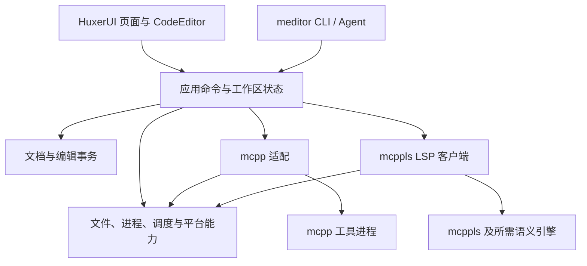

# meditor 项目设计方案

状态：实现中；新增设计与实现计划待 review，产品验收尚未完成。

日期：2026-10-22。  
本文综合前期讨论与现有仓库规范；已确认的约束与待确认的设计建议分别列出。文档按要求放在 `.agnets/docs/`，开发 skills 仍位于 `.agents/skills/`。

## 1. 产品定位与约束

meditor 是轻量级、跨平台、专注 **mcpp 与 C++ Modules** 的产品级现代代码编辑器，支持桌面和手机。产品交互复杂度对标 Dev-C++，同时具备更现代、简洁、优雅的视觉、布局与操作体验。编辑器自有代码采用 **mcpp + C++23 Modules** 实现。

产品工作集中在编辑器界面、编辑能力、交互与生态集成。已有 VS Code + mcpp + mcppls 的开发链路是功能基础，meditor 将它做成集成度更高、负担更小、更专注的独立产品。最终交付必须可安装、可实际开发，不以可运行窗口或演示工程作为完成标准。

典型使用闭环：新建或打开 mcpp 工程 → 编辑 `.cppm`/`.cpp` → 补全、诊断与跳转 → 管理依赖 → 构建、运行、测试 → 定位问题 → 恢复工作现场。

已经确认：

- HuxerUI 提供 UI、渲染、输入和平台基础，使用专用 `meditor` 分支，通过 branch + lockfile 管理；各项修改按实际责任归属划分。
- mcpp、mcppls 是随产品分发的工具，通过已有 CLI/JSON 和 LSP 协议原生集成，不修改两者源码。
- meditor GUI 与完整 CLI 是同一套产品能力的入口；用户、测试及 Agent 通过 meditor 操作，不需要掌握或直接调用底层 mcpp/mcppls。
- 安装包与现代安装器使用 mcpp 插件体系实现；缺失的开发工具可补充到 xim-pkgindex。
- 默认随包提供 mcpp、xlings、mcppls 的固定版本源码工程，作为可打开、可编辑的生态演示，同时作为开发期真实工程可用性验证样本。
- 隐私默认保护：不收集或上传对话、源码和使用遥测；公开内容与导出产物不泄露本机用户名、绝对路径、设备标识或凭据。
- mcpp-vscode 提供部分功能、数据与交互参考，独立编辑器自行实现客户端和界面。
- 编辑器运行时自研组件位于 `modules/`；自有 mcpp 构建插件及仅构建期依赖放根级 `mcpp/`，不与运行时代码混放。`.cppm` 接口与 `.cpp` 实现分离。
- meditor 自有代码采用 GPL 3.0（`GPL-3.0-only`）；Contributors 展示 `Sunrisepeak & mcpp-community`，公开联系邮箱为 `speakshen@163.com`。第三方原始许可与署名保留。
- 使用 mcpp workspace 组织应用和组件；独立包按可复用子系统划分，避免按一两个文件建包；必需头文件收敛在最小适配模块。Linux、Windows、Android、macOS 四端是 0.0.1 产品级发布必达平台。
- 优先采用 mcpp-index 中维护良好、质量可靠、体积适当且覆盖目标平台的库。
- 开发规范以根 [AGENTS.md](../../AGENTS.md) 为准，编码参考 [mcpp-style-ref](../../.agents/skills/mcpp-style-ref/SKILL.md)，构建参考 [mcpp-usage](../../.agents/skills/mcpp-usage/SKILL.md)。skill 中旧工具链或 xmake 示例不覆盖项目约束。

首版范围建议：交付可靠的代码编辑、统一 CLI、mcpp 工程闭环及安装卸载流程，保持 UI 清晰与后台资源可控。通用插件市场、内置 AI Agent 运行平台、多人协作、完整调试器、完整终端模拟器、全语言 IDE 不进入首版；通过 CLI 接受外部 Agent 控制属于首版基础能力。

“轻量”需要通过安装包、冷启动、空闲 CPU、内存和真实文件编辑数据判断。编辑器、工具载荷、示例源码、编译器与项目缓存分别计量，不能只报告 UI 可执行文件大小。

## 2. 技术选择与现有基础

### 2.1 HuxerUI

仓库：`https://github.com/Sunrisepeak/HuxerUI.git`。  
专用分支：`meditor`，已从 `mcpp-live2d-template` 的 `0a207a56b598e102d7eab9dd52fd36933bd9e9c7` 创建并推送。  
本地目录：`../HuxerUI`。

该基线已包含六平台 mcpp 构建、资源模块、Android/iOS/Web 链接及应用分发规则。选它的依据是与 mcpp/Modules 生态的直接结合及可维护的 C++ UI 路径。Live2D 模板不构成 meditor 的依赖或功能要求。

前期核对的基线 CI：Linux GCC/Clang、Windows、macOS、Android x86_64、iOS arm64 模拟器、Web 的 mcpp 构建任务成功；Linux、Android、Web 的默认产物一致性检查成功。这些结果不等同于 meditor 应用构建成功或手机真机编辑体验通过。

- [基线构建设计](https://github.com/Sunrisepeak/HuxerUI/blob/0a207a56b598e102d7eab9dd52fd36933bd9e9c7/docs/design/mcpp-build-system.md)
- [基线 mcpp Build](https://github.com/Sunrisepeak/HuxerUI/actions/runs/35020479985)
- [基线产物一致性检查](https://github.com/Sunrisepeak/HuxerUI/actions/runs/35020479967)

HuxerUI 的现有模块接口包装了其公共 API。meditor 自有业务、UI 页面和编辑组件使用 Modules；框架内部、系统桥接、生成代码和第三方源码不要求全部改写成 Modules。应用入口允许薄 `main.cpp`，只负责导入与启动。

### 2.2 mcpp 与 mcppls

| 组件 | 它决定的事实 | meditor 的职责 |
| --- | --- | --- |
| mcpp | 工程、目标、依赖解析、工具链、构建、运行、测试与打包 | 命令入口、配置编辑、任务生命周期、输出与结果展示 |
| mcppls | C++ 与模块语义、分析上下文、模块准备、语言服务缓存 | LSP 客户端、编辑装饰、状态展示与已有命令入口 |
| HuxerUI | 窗口、布局、渲染、焦点、平台文本输入和生命周期桥接 | 编辑器页面、自定义编辑组件与产品交互 |

不重建 mcpp 的依赖解析器，不直接消费或搬运构建 BMI 供语言服务使用，不另启一个 clangd 与 mcppls 争用同一文档。

## 3. 产品交互

### 3.1 桌面

默认采用 meditor 自绘的统一标题栏，布局由工程/文件导航、编辑区、底部问题与任务面板、状态栏构成。包浏览、模块关系、设置等按需打开，避免启动就加载全部面板。

标题栏不使用系统默认标题栏的视觉：meditor 绘制品牌、工作区、命令入口与窗口控制，统一桌面外观。窗口拖动区、边缘缩放、双击最大化/还原、最小化/关闭、系统窗口菜单、焦点、高 DPI 和辅助访问遵循各平台约定；按钮和标签等交互区不参与拖动。可用原生宿主能力承担 hit-test、拖动和窗口操作，通用窗口能力缺陷归 HuxerUI，标题栏布局与编辑器交互归 meditor。Wayland、Windows、macOS 分别原生验证，不能只隐藏装饰后认为已完成。手机保留统一产品顶部栏，适配安全区、系统返回和软键盘，不照搬桌面窗口控制按钮。

底部状态栏固定承载工作区/目标、构建与语言服务状态、光标行列、编码/换行及设置入口；点击状态项进入对应详情或操作。设置可从底部入口、命令面板、快捷键与 meditor CLI 到达，同一设置模型驱动 GUI/CLI。窄屏按优先级收纳次要状态，保留必要状态及设置入口，适配触摸和系统安全区，避免密集图标与只能 hover 获取的信息。

首版单工作区、多个文档标签；分屏与多窗口后续增加。文件搜索、命令面板和快捷键复用同一命令模型。构建、运行、测试必须能显示当前工程、目标与执行状态，并可取消。

欢迎页提供 mcpp、xlings、mcppls 三个内置工程入口，展示固定版本、示例说明与当前平台可用操作。选择“创建示例工作副本”后打开普通工程；示例使用相同编辑和工具链路径，不维护一套只能演示的特例界面。单根工作区意味着一次打开其中一个工程，可以切换，不要求三者同时加载。

### 3.2 手机与平板

手机以单编辑区为主：导航按需展开，问题、补全说明、构建结果使用适合小屏的面板。提供 Tab、Esc、常用括号等代码输入辅助；处理软键盘遮挡、长按选择、外接键盘、系统返回和后台恢复。

平板可随可用宽度展开导航和辅助面板。布局依据窗口尺寸与输入方式调整，避免只按操作系统硬编码桌面/手机两套产品。

### 3.3 状态表达

“文档是否保存”“任务是否成功”“语言服务是否就绪”分别显示。模块准备期间保持编辑与保存可用；源码错误不能被渲染为整个编辑器不可用。

构建配置中的目标、profile、features 与语言服务已采用的分析上下文分别呈现。请求切换尚未生效时显示待应用状态，不能把请求值当成已采用值。

### 3.4 视觉、布局与动画

建立统一设计变量：色彩、字号、行高、间距、圆角、层级、焦点和状态反馈。使用清晰的信息层级、克制的图标与留白；提供深浅主题、缩放和高 DPI 支持。代码字体优先可读性，导航文字与代码字体可分别设置；颜色不作为错误或状态的唯一标识。

布局遵循可用空间而非固定像素，编辑区拥有主要空间；侧栏和底部面板可收起、调整尺寸并恢复布局。常用操作可通过命令面板、键盘和触摸到达，手机不依赖 hover。错误、空白、加载和离线状态均有正式设计，界面不泄露工具参数等实现细节。

动画用于面板展开、导航切换、焦点及状态变化，建议常规过渡约 120–200 ms，实际在原型和设备上调整；输入、光标、补全与任务输出不等待动画结束。支持减少动画及关闭动画，空闲时不持续重绘或播放装饰动画。

每个主要页面至少交付桌面与手机布局、交互状态及键盘/触摸流程，并通过截图和实际操作 review。功能测试通过不能替代视觉验收；CLI 状态断言也不能证明像素布局、动画流畅或 IME 正确。

### 3.5 Headless 布局、交互与动画测试

项目必须具备无需系统窗口和显示服务的 UI 测试模式，复用产品的 HuxerUI 视图树、状态、布局、交互和动画逻辑。CLI 应用服务测试与 UI headless 测试分别覆盖各自责任：前者验证命令事务，后者实际挂载视图并计算布局、分发输入和推进动画，不能只检查 CLI 状态或在测试中重写页面行为。

- 使用可配置 viewport、缩放、主题、字体与输入方式；检查桌面、平板和手机布局，以及缩放、旋转、安全区、长标签、空白、加载和失败状态。断言关键控件可见、不重叠、不越界，标题栏拖动区不吞按钮，底部状态及设置入口始终可达；必要时生成离屏截图与语义树辅助 review。
- 通过公共 Runtime/测试接口注入键盘、指针、滚动、触摸与语义动作，验证焦点、标签切换、编辑/撤销/保存、设置与面板切换。测试连接同一应用核心，使用独立合成工作区与确定性工具 fixture，不连接开发者真实会话，也不向宿主桌面注入输入。
- 动画使用可注入的单调虚拟时钟，逐帧推进到开始、中间和结束，验证位置、透明度、最终布局、输入响应，以及快速反向切换、中断、取消和销毁后的清理。检查减少动画/关闭动画路径与空闲时停止调度；不靠真实 sleep 猜测过渡结束，不以静态截图代替动画断言。
- 提供可脚本化驱动与机器可读断言结果，供 CI 和 Agent 使用。测试能力经独立 headless 模式及 capability/schema 明确公开，避免测试驱动默认连接或控制其他用户窗口。运行不要求启动 mcppls、下载工具链或打开真实系统对话框；相关边界由可控适配器替身处理，并另跑原生集成测试。
- 截图采用固定合成内容及字体环境，同一受控渲染器内比较；跨平台不盲目要求逐像素一致。公开证据仍执行隐私扫描。headless 能证明布局及共享交互行为，原生标题栏宿主桥接、IME、剪贴板、读屏、GPU 呈现与真机触摸继续保留原生/真机验收。

实现优先复用 HuxerUI 现有 Runtime、测试宿主及确定性帧调度接口；通用测试能力不足时在其 `meditor` 分支补齐，产品场景和断言保留 meditor。本节是交付要求。当前已有输入契约测试、局部 headless 工作台布局/主题动画/减少动画回归及 Linux 原生窗口回归；这些是局部证据，完整产品场景和平台覆盖仍需继续补齐。

## 4. 架构与目录



建议目录；这里只描述职责，不代表每个目录都创建一个独立包。实际按工作量和职责聚合，避免一次生成大量空壳：

```text
meditor/
  AGENTS.md
  mcpp.toml
  mcpp.lock
  build.mcpp
  src/                   GUI / CLI 入口与装配
  modules/
    document/           文档、位置索引、事务、撤销重做
    editor/             可见行布局、光标、选择、编辑命令、装饰
    workspace/          工程会话、配置选择、文件树、应用命令
    commands/           GUI/CLI 共用命令、参数、结果及能力描述
    cli/                meditor 命令行、JSON 输出与会话连接
    mcpp/               CLI 协议、任务、包与工具链数据适配
    lsp/                JSON-RPC/LSP 客户端及 cxxModules 扩展
    platform/           文件、进程、调度、平台文件授权
    ui/                 HuxerUI 编辑面与工作台页面
    i18n/               可复用的语言选择、消息键、格式化与回退
    onboarding/         Quick Start 状态、步骤与结果验证
    about/              产品及随包依赖元数据的运行时读取与呈现
  mcpp/        自有 mcpp 插件、构建期依赖、资源/声明生成
    distribution/       仅构建期的载荷规划与 mcpp 打包规则适配
  windows/installer/    Windows 现代安装界面与资源，沿用插件约定
  resources/
  examples/manifest.json  三个源码工程的版本、归档、许可与验证元数据
  tests/                跨组件和真实应用闭环验证
  .agents/skills/
  .agnets/docs/
```

- 可独立复用的子系统以 mcpp 包组织，显式声明依赖；内部命令、协议类型、CLI 解析等可作为所属包的 named modules，不必各建一个包。组件单测放在自身 `tests/`，独立包验收见第 8.1 节。
- 依赖方向：文档核心不依赖 GUI、LSP 或构建工具；编辑逻辑只依赖文档与必要类型；应用装配连接服务与 UI。
- HuxerUI 相关输入和绘制代码集中在 UI 适配，文档及编辑算法保持可无窗口测试。
- CLI 入口不依赖窗口初始化，公用应用服务不依赖 HuxerUI；GUI 本地输入也转换为同一事务和命令，避免 CLI 另写一套逻辑。布局状态由可选 UI 服务拥有。
- 模块名使用 `meditor.<component>[.<part>]`；公共命名遵循风格 skill。接口保留声明及必须可见的模板/constexpr 定义，常规函数体进入 `.cpp`。
- 平台和第三方头文件优先留在适配模块的 `.cpp`；仅接口类型必须使用时才进入对应 `.cppm` 的全局模块片段。集中封装重头文件、私有 include 路径不外泄；不使用全局门面再导出全部子系统或 `std`。C ABI、JNI、Objective-C++ 和生成器确需头文件时保留最小桥接，不以“无头文件”破坏平台能力。

## 5. 文档与代码编辑组件

### 5.1 所有权

建议自研 `CodeEditor`，利用 HuxerUI 已有文本输入、焦点、布局和绘制能力。文档核心拥有唯一权威文本和修订号；UI、LSP 与保存流程读取同一文档快照。每个编辑视图单独拥有光标、选择和滚动位置。

基础标识为 `DocumentId`、`Revision` 和基于范围的编辑事务。一次用户操作可包含多处修改，整体进入撤销历史。选择替换、粘贴、自动缩进、LSP WorkspaceEdit 共用事务入口，禁止旁路修改文本。

### 5.2 缓冲和位置

建议使用 UTF-8 存储、带行与 UTF-16 长度索引的分段 piece table；在里程碑一验证后确认具体实现。先评估生态中可复用的基础结构，再决定自行实现部分。不承诺未经测量的数据结构性能。

位置转换必须显式区分：字节偏移、UTF-16 code units、Unicode 标量、用户感知字符、屏幕坐标。LSP 按协商的 position encoding 转换；HuxerUI 输入边界使用其 UTF-16 偏移约定。光标移动和删除按字符边界处理，覆盖组合字符、emoji 与制表符；不能把字节索引直接当屏幕列。

支持 UTF-8/BOM 和 LF/CRLF，保存时保留原换行约定。其他编码无法可靠读取时明确提示或提供只读查看，不以替换字符覆盖原文件。超大文件和超长单行提供受限模式，避免阻塞 UI。

### 5.3 输入与呈现

- 对接 HuxerUI 的 `TextInputClient`/输入命令批次，复用平台 IME 会话；具体可用接口在原型中核对，框架公共接口或实现缺陷在 HuxerUI 分支补齐，meditor 专用编辑行为在本项目实现。
- IME composition、提交和取消有明确事务边界；候选输入不按普通快捷键解释，Undo 不拆成逐个候选字符。
- 只布局和绘制可见区域及有限预取范围；根据文档版本、字体和宽度使行缓存失效。异步高亮不能覆盖新版本。
- 默认内置 C++/C++ Modules、Markdown 及常见源文件/配置文件的基础语法高亮，无须用户另装扩展。语法高亮提供即时基础反馈，LSP semantic tokens 补充 C++ 语义；语言识别、覆盖范围、主题与性能要求见第 17 节。高亮依赖先选库并验证 Modules 语法覆盖，首版允许保守词法实现，不能冒充完整 C++ 解析。
- 首版具备单选择、行号、缩进、查找替换、诊断装饰、补全和跳转；多光标、折叠、minimap 后续扩展。

### 5.4 保存与恢复

保存基于不可变快照，采用平台支持的安全写入/替换流程。保存完成只清除对应版本的未保存状态；保存过程中继续编辑的内容仍标记未保存。

会话与恢复数据写入应用数据目录，不污染源码。定期保存未落盘修改的恢复记录，重启时比较磁盘版本，冲突时保留两份并提示选择。首次打开、新建、重命名、外部修改、删除和权限失效都要有明确状态。

拥有文件能力的浏览器或手机路径不一定是普通本地路径。文件服务携带授权和写入能力；对不具备原子替换的 provider 使用其支持的提交方式并报告失败，不假定 POSIX 语义。

## 6. 工具与语言服务集成

### 6.1 mcpp

- 独立适配层构造 argv，以工程目录为 cwd；不把用户文件名拼接为 shell 命令。
- 从 stdout 正向识别 `schemaVersion`、`kind`、`kindVersion`，根据能力选择机器输出；未知字段容忍，未知协议明确降级。不能只凭退出码识别协议，也不能混淆旧 `--json` 和 `--format json`。
- 保留 stderr 与原始任务日志；对没有结构化格式的命令显示日志，避免将人类输出解析成稳定协议。
- 首版接入工程创建、build/run/test、依赖增删、工具链选择。包浏览和完整缓存维护在后续阶段加入。
- 任务状态为排队、执行、取消中、成功、失败或取消；取消管理完整进程树。同一工程的构建类任务默认串行，避免配置与构建产物竞争；UI 和只读文档服务继续运行。
- 默认构建已保存文件；有未保存修改时提供保存后构建或明确提示。不会让用户误以为正在运行未保存文本。

### 6.2 mcppls

建议首版每个工作区一个 mcppls 会话，通过 stdio JSON-RPC/LSP 连接，进程生命周期由工具宿主管理。

首版实现 initialize、shutdown、文档同步、diagnostics、completion、hover、signatureHelp、definition、documentSymbol 和必要 workspace 消息；semantic tokens、references、rename/WorkspaceEdit 按里程碑补齐。客户端只声明已经实现的能力，支持取消、超时、崩溃后有限重启与状态降级。

文档修改使用单调 LSP version；根据服务端声明选择增量或完整同步。补全等异步结果检查请求版本与当前位置；有版本的诊断检查版本，无版本的结果在重启和上下文切换时清理，避免把旧结果当当前事实。多文件修改先验证相关文档、版本和权限，再形成可撤销事务；失败时不留下部分应用的改名。

Modules 功能按服务端 capability 协商启用：

| 现有接口 | 产品功能 |
| --- | --- |
| `cxxModules/status` | 模块准备、语义环境与故障状态 |
| `cxxModules/graph`、`moduleInfo` | 模块关系、分区与提供者 |
| `cxxModules/contexts`、`setContext` | 文件分析上下文 |
| `cxxModules/report`、`cache` | 诊断详情与语义缓存 |
| 服务端声明的 sweep/reset 命令 | 缓存维护 |
| `cxxModules/completionReady` | 光标与版本未变时重新请求补全 |

mcpp 构建缓存和 mcppls 语义缓存分别展示、分别维护。依赖查看必须有参考 mcpp-vscode 的可交互节点连线图：包/项目依赖图与 C++ Modules import 关系图分别呈现，可在同一图面板切换。模块图显示已提供的关系与角色；构建影响、耗时或重建原因只在后端提供可靠数据时展示。具体图交互与教学验收见第 15.3 节。

现有 S3 的无文档 graph 等接口在多根工作区有范围限制，因此首版采用单根工作区。上下文切换是针对文件的分析选择，不能代替 mcpp 的目标/profile/features 配置。

### 6.3 随包工具

按平台打包经验证的 mcpp 和 mcppls 完整载荷，记录版本、来源、摘要与许可证；程序通过应用安装位置定位工具，用户数据和缓存进入所选运行模式的可写数据目录。正式支持安装模式与桌面自包含便携模式，后者解压后由 meditor 完成目录定位与首次准备，无须用户手工配置工具 home。默认不依赖机器 PATH；可提供显式选择外部工具的设置与兼容性检查。目录、重定位和验收要求见第 16 节。

固定工具版本与 lockfile 中解析出的 HuxerUI 版本组成发布矩阵。工具升级独立验证，不在一次 GUI 更新中无记录替换全部基础设施。首版随包开发工具；编译器、SDK 和用户依赖按 mcpp 机制准备，不预装全部工具链，以控制初始分发体积。UI 与 CLI 提供统一的环境准备、进度和修复入口，不要求用户执行底层安装命令。

### 6.4 默认源码示例与可用性样本

默认发行包同时携带 **mcpp、xlings、mcppls 三个项目的固定版本源码归档**。它们有两个用途：让用户直接浏览和体验真实 Modules 工程；让开发过程持续以真实项目检验 meditor 的可用性。

xlings 在这里作为源码示例纳入，不因此自动增加一个常驻服务，也不改变 mcpp/mcppls 的既定集成边界。若 mcpp 的工具运行机制需要 xlings 运行载荷，应按实际工具依赖闭包处理，与示例源码分别管理。

**版本与打包：**

- `examples/manifest.json` 记录项目标识、上游地址、commit、源码归档摘要、许可证及 NOTICE、入口工程目录、依赖准备说明、按平台验证过的操作与测试选择。此处为拟定文件，不代表已经生成归档或确认示例提交。
- 源码在发布准备时按 commit 获取，打包为压缩归档；必要的子模块按各自固定提交收集，不将不完整的源码树标为可构建工程。默认包含开发所需源码、manifest、测试及必要资源，排除 `.git` 历史、构建产物、缓存和无关大文件。裁剪不能破坏所声明的构建或测试路径，并记录排除项。
- 原样保留来源和许可说明，不为展示而修改项目代码；源码包与二进制工具分别固定版本，尽量匹配，存在版本差异时明确记录。更新示例必须重新验证，不在启动或打开工程时自动跟随远端分支。
- 默认安装内容包含三份源码归档，浏览和编辑不依赖首次联网下载；编译器、SDK 和外部依赖仍可能需要网络。分别报告归档体积、展开体积、依赖下载量和缓存，启动不解压或索引全部示例。

**用户工作副本：**

- 用户选择位置后，将固定示例解压到可写工作目录；安装包中的归档保留为原始版本。手机和 Web 使用平台允许的可写存储及授权流程。
- 示例副本可正常修改、保存、索引和构建；更新应用或示例不能覆盖已有副本。恢复为原版通过重新创建副本完成。
- 从示例编译出的 mcpp、xlings 或 mcppls 产物只是该工程的输出，不自动替换 meditor 正在使用的随包工具。
- 构建、测试或运行必须来自明确用户操作；大型或修改环境的测试不默认全量执行，采用记录在清单中的适合演示的验证子集。

**开发验证：**

| 样本 | 重点体验 | 验证路径 |
| --- | --- | --- |
| mcpp | 工程发现、Modules 导航、配置与构建程序编辑 | 打开、搜索、import 跳转、编辑实现、增量构建、选定测试 |
| xlings | 真实应用工程、跨组件导航与持续编辑 | 多文件切换、补全、保存恢复、适用目标的构建和选定测试 |
| mcppls | 编辑语言服务自身代码时客户端与工具的隔离 | 模块与符号导航、诊断、构建；运行中服务故障不影响源码编辑 |

每轮测试从固定归档创建隔离副本，记录 meditor/HuxerUI/工具/示例提交、目标、缓存条件及具体操作。验证至少覆盖打开、编辑、保存恢复、查找和模块导航；具有工具能力且上游工程支持的环境再验证构建与选定测试，不推断三个工程在所有平台上均能编译或执行。

保留小型受控工程定位单项故障；三个真实工程承担整体可用性和性能回归。M1 使用其源码验证编辑行为，M2 开始形成工具闭环，M4 使用与发行包相同的归档复验。没有实际运行的场景标记未测，不能用构建成功替代补全、IME 或真机交互结果。

### 6.5 统一 meditor CLI 与 Agent 操作

**原则：** CLI 覆盖 meditor 所有可操作的产品能力，包括文档修改、语义查询、工程/包/工具链操作、任务、Modules 视图数据、示例、配置和诊断。每项功能在加入 GUI 时同时定义命令、参数、结果与能力条件。CLI 不只是底层命令透传，不能把 mcpp/mcppls 的命令、路径和状态拼接责任交回用户或 Agent；底层工具版本可作为排障信息查看。

**命令草案（待实现，不代表当前已存在）：**

| 命令族 | 覆盖能力 |
| --- | --- |
| `meditor open`、`workspace`、`session` | 打开工程、会话选择、状态与关闭 |
| `meditor document` | 打开/读取、范围编辑、保存、撤销重做、查找替换、恢复 |
| `meditor language` | 补全、悬停、签名、定义、引用、诊断、符号和语义重命名 |
| `meditor project`、`package`、`toolchain` | 工程创建、目标/profile/features、依赖搜索管理、环境准备 |
| `meditor build`、`run`、`test`、`task` | 构建运行测试、进度、日志、等待与取消 |
| `meditor modules`、`cache` | 模块关系/详情、分析上下文和分类缓存维护 |
| `meditor example`、`settings`、`doctor` | 示例工作副本、设置、环境自检与脱敏报告 |
| `meditor ui` | 已运行界面的逻辑布局、面板、焦点和命令控制；截图等敏感导出显式请求 |
| `meditor capabilities`、`help` | 枚举版本、可用命令、参数 schema、当前宿主能力 |

**共享内核与会话：** 无窗口命令直接调用应用服务；需语言服务时按需启动 mcppls，会话结束释放资源。长任务和持续 Agent 操作可使用显式 `meditor serve` 会话。默认没有额外常驻全局守护进程。GUI 运行时暴露受限的本地会话接口，CLI 可连接同一会话，复用未保存文档、撤销历史和服务实例。

每个工作区的活动文档只有一个权威会话。CLI 自动发现会话时必须返回采用的 session ID；存在歧义时要求 `--session`，不能猜测目标。修改文档需提供预期 revision，冲突返回错误且不部分执行。GUI 已有未保存文档时，CLI 不静默另开磁盘副本修改同一文件；支持显式磁盘快照只读查询。任务明确说明输入来自保存后的源码，不能把内存编辑冒充已构建内容。

**协议与输出：** `--format json` 输出版本化 envelope，包含 kind、request ID、session ID、结果、诊断和实际 effects；日志与进度不污染 stdout JSON。流式任务使用显式 JSONL 模式，序号与 task ID 可关联，结束事件携最终结果；普通模式等待任务终态，后台模式返回 task ID。支持超时、取消及可协商的空闲等待，不依赖任意 sleep。区分使用错误、能力不可用、版本冲突、超时、取消和任务失败的稳定错误码；任务已启动或命令已接收不算成功。

人类默认获得清晰文本，Agent 使用 schema 和 JSON。破坏性维护提供预览或 dry-run；非交互模式不弹 GUI 对话框，缺少必要选择时返回可操作错误。预先授权过的工程策略可复用；CLI 不通过永久 `--yes` 偷渡执行或联网权限。

**本地访问与隐私：** 会话仅对当前用户授权的本地客户端开放，优先采用用户权限隔离的 Unix socket/Windows named pipe，并验证会话身份；不默认监听网络端口。只读查询与修改权限分开。状态和诊断 JSON 默认使用相对路径或占位符；显式文档读取会按本机调用者请求返回源码，这属于已授权编辑功能，不是日志导出或上传。测试/Agent 日志不得默认记录这些正文。截图、报告和对话不自动外发。

桌面提供直接运行的 meditor CLI。Android/iOS/Web 不能假定拥有桌面 shell；设备和浏览器测试通过宿主侧 `meditor` runner 连接受控应用会话，复用同一命令协议，桥接需验证且不默认开放公网或绕过授权。尚无桥接或后端能力时返回明确不支持，不能用桌面模拟结果代替设备验证。

**验收：** 真实工程从创建工作副本、打开/编辑/保存、补全/诊断、构建测试到关闭恢复，均能通过 meditor 命令执行和断言；GUI 可与 CLI 交替操作同一文档且结果一致。交互式运行支持受控 stdin/stdout，完整终端模拟器仍可后置；不支持的交互需求不能静默挂起。先用 CLI 稳定覆盖行为回归，再补必须的视觉、IME、触摸与动画测试。

### 6.6 产品打包、现代安装器与工具供应

发行使用 mcpp 的插件/规则包体系和 HuxerUI 已有分发规则，meditor 定义应用身份、图标、版本、资源、工具载荷与安装 UI。复用构建闭包及平台安装机制，不在本项目重写打包引擎，不修改 mcpp/mcppls 源码。需要的产品规则和资源放在对应 meditor 模块，通用插件能力优先复用现有包。

| 平台 | 计划交付 | 验收重点 |
| --- | --- | --- |
| Windows | `setup` 现代安装器，复用 Burn/MSI 插件路径及应用自有安装界面 | 清晰的安装进度、失败恢复、升级/卸载；PATH/文件关联等可选项可撤回；签名与原生环境验收 |
| Linux | 以现有 `appimage` 等插件路径为基础 | 干净环境依赖完整、可启动、CLI 可发现、数据目录正确 |
| macOS | `app`/`dmg` | bundle、签名、公证及 CLI 入口按实际发布环境验证 |
| Android | `apk`，按分发需要生成 `aab` | 完整资源/工具载荷、签名、安装升级和后台恢复 |
| iOS | 应用 bundle，交付签名包需 Apple 流程 | 实际安装及平台允许的工具能力 |
| Web | `web` 静态产物 | HTTP 部署、资源、持久化、能力说明与缓存更新 |

Windows 安装器沿用 HuxerUI/mcpp 规则的 `windows/installer` 扩展点，视觉与 meditor 设计变量保持一致。安装与升级不改用户项目；卸载默认保留工作区与恢复数据，清除缓存/个人数据由显式选择触发。更新从完整、经校验的新版本切换，失败保留可用旧版本；自动更新是否提供及策略另行 review，首版至少提供可靠的手动升级。

缺少的开发工具或打包工具优先添加到 **xim-pkgindex**：记录上游来源、固定版本、校验值、许可、宿主架构、安装/探测及卸载行为，通过包来供应。**mcpp-index 管模块库和规则依赖，xim-pkgindex 管工具载荷**，两者不混用。新增索引包属于配套生态工作，必须有安装与干净环境验证，不用源码修改或机器预装绕过缺口。

“开箱即用”验收：安装后能启动 GUI 与 meditor CLI，使用随包工具和示例；必要的编译器/SDK/依赖由 meditor 引导准备，过程可见且可恢复。依赖未缓存时首次构建可能联网；无网络且缺少依赖必须说明，不承诺从空环境完全离线编译所有示例。索引新增包及插件组合是否适用于各宿主需要实测，文档中的格式名称不是已经交付的产物。

## 7. 平台能力边界

| 平台 | UI 与文件编辑 | 本地工具执行 | 首轮验证重点 |
| --- | --- | --- | --- |
| Linux | 原生 HuxerUI | 采用已有工具载荷 | 实际工程编辑、依赖、构建运行 |
| Windows | 原生 HuxerUI | 使用 Windows 载荷 | Wine 检查后补原生环境 |
| macOS | 原生 HuxerUI | 使用 macOS 载荷 | Apple 环境构建、打包与输入 |
| Android | 原生 HuxerUI | 必须验证原生载荷或受控本地工具宿主，覆盖 ABI、进程、工具闭包和存储；Termux/PRoot 是候选而非已交付能力 | 真机 GUI/CLI 开发闭环、输入、文档授权和后台恢复 |
| iOS | 原生 HuxerUI | 不预设桌面工具启动模型成立，单独验证宿主与分发可行性 | Apple 环境、签名、输入与文件操作 |
| Web | HuxerUI Web/WASM | 浏览器不直接启动桌面 mcpp/mcppls | 编辑、资源、存储、输入；工具能力单列 |

UI 构建成功、应用安装成功、工具能启动、真实开发闭环通过，是四个分别记录的结果。手机页面始终可编辑，工具不可用时说明具体缺失能力。

本设计不强制首版建设远程开发平台。保留文件与工具宿主替换边界，Android 必须通过受控的实际工具宿主完成开发闭环；若需外部宿主，其准备、连接、异常恢复和隐私都属于产品验收，不能把手工环境搭建留给用户或以桌面模拟替代。不满足第 10 节时 Android 仍未达发布标准，不能改称只编辑版而判为通过。iOS/Web 是额外探索平台，不阻塞四端既定目标，也不能借此降低四端标准。

## 8. 依赖、分支与修改归属

HuxerUI 统一通过 `branch = "meditor"` 引用，不在 manifest 中反复手改 commit；`mcpp.lock` 固定实际解析版本。需要采用分支新版本时执行 `mcpp update huxerui.huxerui`，验证后提交更新的 lockfile；发布沿用已验证的 lockfile，记录解析 commit 供追溯，不改成 `rev`。branch 不表示每次构建自动追踪最新 HEAD。本地联调可临时使用 path 依赖，不能把开发机器的绝对路径提交为产品默认依赖。

```toml
[dependencies]
huxerui.huxerui = { git = "https://github.com/Sunrisepeak/HuxerUI.git", branch = "meditor" }
```

| 修改内容 | 归属 |
| --- | --- |
| 文档、事务、编辑命令、编辑绘制策略、工作台、包与模块视图 | meditor 的 `modules/` |
| HuxerUI 公共契约或内部实现的通用 IME、焦点、文本测量和渲染问题 | HuxerUI `meditor` 分支 |
| 仅 meditor 的选择策略、代码绘制、键盘命令、设备文件授权和生命周期策略 | meditor 对应 editor/platform/ui 等模块 |
| 工具调用、CLI、错误呈现、载荷装配与应用安装器 | meditor 对应模块和安装器目录 |
| 确认的 mcpp/mcppls 缺陷或现有协议不支持的需求 | 记录复现与能力限制，本项目不修改其源码；按现有接口适配，不能伪造结果 |
| 缺少的开发/打包工具 | xim-pkgindex 包及必要的 meditor 供应适配 |

判断依据是职责和契约：问题能否在不依赖 meditor 业务的最小 HuxerUI 应用中复现，是否违反框架公共行为，其他应用是否也受益。仅涉及平台 API 不足以归入 HuxerUI；只有本项目需要的行为应留在 meditor。跨层问题分别修复各自责任，不把业务逻辑塞进框架，也不在应用里复制整个框架子系统。

生态库按维护情况、目标平台实测、依赖闭包、许可、接口稳定性和包体评估。JSON/TOML、日志、Unicode、进程和文件等通用设施先检索 mcpp-index；选库时记录理由与版本。尚未完成验证的候选不列为确定依赖。

### 8.1 workspace、独立组件与头文件边界

区分 C++ named module 和 mcpp package：前者划分代码可见性与编译单元；后者划分依赖、构建、测试和未来发布单位。同一包可以有多个 `.cppm`/`.cpp`；一个目录或一两个源文件不是独立包的充分理由，文件数量也不是机械门槛。

新增独立 `mcpp.toml` 的组件须同时满足：

1. 有完整子系统职责和稳定公共接口，能描述除 meditor 当前 UI 装配之外的真实复用场景。
2. 不依赖应用入口、全局工作区、GUI 单例或根目录隐式 include/链接状态，依赖闭包在自身 manifest 中声明。
3. 可以按成员独立构建、测试，并有一个外部最小消费工程验证其公开接口；不能靠根应用将缺失依赖间接带入。
4. 源码、资源、头文件和依赖许可清晰；具备包版本、模块名、平台能力、错误/资源所有权说明，未来可转换为索引依赖并打包分发。

文档缓冲/事务是优先评估的可复用组件；代码编辑控件、平台工具宿主是否独立，取决于职责和实际依赖。命令常量、少量 JSON 转换、单个平台辅助函数留在所属包内，不为目录对称拆包。当前初始实现中的包划分只是候选，不因已创建 manifest 就默认通过此标准。

workspace 根统一维护成员、共享依赖、标准和工具链；GUI、CLI 作为应用目标/成员，共享组件包。以下是结构示意，不代表每个目录现已实现，也不要求立即将所有候选拆包：

```toml
[workspace]
members = ["modules/core", "modules/platform", "modules/application", "apps/cli", "apps/gui"]

[workspace.package]
version = "0.0.1"
standard = "c++23"
mcpp = ">=2026.10.10.1"

[workspace.toolchain]
default = "llvm@23.1.3"

[workspace.dependencies]
meditor-core = { path = "modules/core" }

[workspace.dependencies.huxerui]
huxerui = { git = "https://github.com/Sunrisepeak/HuxerUI.git", branch = "meditor" }
```

成员仅继承真正使用的依赖，例如 `meditor-core.workspace = true`；核心包不为共享配置而获得 HuxerUI 依赖。平台条件、ABI、运行时及 SDK 要求属于目标/包的真实依赖，不能靠宿主环境变量让构建偶然成功。具体配置与成员命令按 mcpp 当前 workspace 文档核对。

头文件默认私有，优先放实现单元全局模块片段。C/JNI/平台桥接所需公共头仅属于相应适配包，最小声明集、禁止导出框架巨型 umbrella 或向全工程注入头文件。CI 检查 include 归属、公共依赖闭包和独立消费者；生成的本机绝对路径不写入公开包。对未来独立分发的组件，额外验证打包后的消费者，不仅验证源码 path 依赖。

README 保持产品一句话、开发状态、最短构建入口和设计/规范链接；架构、平台差异、操作细节及验收记录进入专门文档，不堆到首页。

### 8.2 openkal 可行性结论

已检查 openkal 的声明包、Linux/Windows/macOS/Emscripten 实现、musl/libc++ 运行时包、mcppls 的平台层和 HuxerUI 构建规则。详细证据、采用条件与探针见 [openkal 可行性分析](2026-10-22-openkal-feasibility.md)。

结论：**以 openkal 为平台能力实现候选是可行方向，不能据此承诺整个 GUI 自动跨平台。** 文档与编辑核心保持标准 C++；平台层优先验证直接导入 openkal 的文件、流、进程、超时和任务能力，保留目标原有 C/C++ 运行时。HuxerUI 继续承担 GUI、IME、窗口、文件授权等系统交互；mcpp 承担目标选择、工具链和构建规则。

`openkal` 声明、目标实现、`openkal-musl` 和 `openkal-llvm-runtime` 是不同层。GUI 图若整体改用 musl/libc++，需要与 GTK、Win32、Apple/JNI 桥接及库闭包证明 ABI、线程/TLS、异常、分配释放一致；不得因 mcppls 使用该组合就认定 GUI 可直接照搬。原生运行时 + 直接 openkal 接口先做小范围探针，整栈运行时替换暂不列为首版必选。

Emscripten 实现明确不提供进程接口；Android 的 Linux 内核不等于已验证 NDK/Bionic、应用沙箱和工具执行能力。自动交叉构建只在目标实现、所需接口、SDK、链接及打包规则齐备时成立；缺少能力必须在依赖解析、链接或明确运行错误中暴露，不通过空实现冒充。Linux 生成跨目标产物与在对应 OS/真机运行通过分别验收，macOS 构建/签名继续使用 Apple 环境。

## 9. 线程、资源与健壮性

- UI 线程只处理输入、状态提交和必要布局；文件遍历、搜索、工具 IO 和解析在后台执行。
- 后台任务绑定工作区/文档生命周期，关闭后取消；结果携文档版本或任务代次，过期结果不覆盖当前状态。
- 日志输出有界缓冲并可写盘，包列表和文件树按需加载，模块图按可见范围裁剪，避免单次全量渲染。
- 工程打开不会默默下载、构建或执行 `build.mcpp`。首次打开未信任工程先提供源码编辑；执行或允许联网操作由可理解的操作入口触发，选择可按工程记忆与撤回。
- 服务端故障不影响文档保存；错误携带恢复入口与可复制诊断，日志和诊断包不自动上传。

### 9.1 隐私与数据边界

**默认行为：** 不收集使用遥测，不读取或上传开发者和用户的对话、提示词及 Agent 会话记录。源码、恢复数据、工作区状态和诊断信息默认仅保留本机；依赖下载等必要网络操作遵循已有明确入口，不将这些数据附加发送。未来任何在线功能必须另行 review 数据范围和显式授权，不能复用依赖下载授权上传源码或诊断。

**仓库与演示：** 设计文档记录产品决策，不保存原始对话。示例、截图、测试数据、提交说明和发布说明使用合成身份与工程相对路径，禁止写入真实本机用户名、主机名、设备序列号、绝对路径、凭据和私有仓库地址。上游公开署名与许可证依法原样保留，不能为脱敏篡改归属信息。默认源码示例按允许清单收集，排除 `.agents/`、`.agnets/`、`.claude/` 等开发会话和机器配置目录；若某路径确属上游构建必需输入，先审查并显式列入，不能整目录无差别打包。

**运行时数据：** 执行工具和文件操作需要真实路径，它们仅在本机运行时使用，不成为源码中的硬编码路径或默认公开报告。工作区内引用优先显示相对路径；外部路径在一般状态和诊断摘要中使用占位符，文件选择等必须辨认实际位置的本机界面按需显示。恢复记录按敏感源码数据管理，提供按工程清除和保留策略；外部文件删除或未保存文档恢复时避免静默销毁唯一副本。

**日志与导出：** 原始工具输出可能带路径、命令参数、环境变量及源码片段；默认日志减少此类内容，排障时需要的原始输出仅在本机受控保留。导出通过统一脱敏层，覆盖结构化字段和嵌套文本，将真实路径替换为 `<workspace>/…`、`<home>/…`、`<toolchain>/…` 等一致占位符；同一路径在一份报告中保持对应关系。移除凭据、URL 用户信息和敏感查询参数，默认不附源码正文、对话、完整环境变量或完整命令行。已有 mcppls 诊断包仍需检查后才能进入 meditor 导出流程。

CLI 中显式读取文档、请求补全和执行编辑属于本机用户授权的产品操作，可返回完成任务所需的源码和工程相对位置；它与诊断导出分开。JSON 中会话身份使用不含机器路径的 ID。CLI 自动化不得默认把正文、stdin、会话访问凭据或完整返回值写入审计日志；无 UI 的报告保存以显式导出命令和脱敏结果为准，不能因没有预览窗口而输出原始报告。

脱敏后的内容可预览，由用户主动选择保存或分享；不自动上传或自动发 issue。不识别的二进制附件默认不纳入导出，无法安全脱敏时停止该项导出并说明，不能退回原始内容。

**构建与发布：** 安装包、源码归档和发布附件采用明确文件清单，排除 Git 历史、对话记录、`.env`、密钥、日志、缓存和本机配置。检查路径在源码、生成资源、调试信息、source map 及工具载荷中的暴露；优先使用编译路径映射和调试产物分离，映射后的产物仍需验证。发布清单中允许公开上游仓库与工具版本，但不附构建机器身份。检查发现泄露应阻止发布并重新生成产物。

**验证：** 为脱敏层提供合成 Linux/macOS/Windows 路径、URI、反斜杠与转义、嵌套错误、带凭据 URL 等样例；验证用户名、绝对路径、秘密值和对话标记均不出现在导出结果。发布检查覆盖示例、安装包和调试附件；对源码片段、截图等无法仅靠字符串匹配判定的内容进行人工检查。日志入口不假定上游工具输出天然安全。

## 10. 里程碑与验收

| 阶段 | 交付 | 通过条件 |
| --- | --- | --- |
| M0：产品骨架与平台探针 | mcpp workspace、HuxerUI branch/lock、GUI/CLI 入口、命令 schema、设计变量、工具定位、源码示例清单与打包骨架 | 无窗口 CLI 和 Linux UI 运行；Windows/Wine、Android 真机、Web 分别记录结果；Android 本地工具探针有实测结论 |
| M1：可用编辑内核 | 文档事务、IME、可见行布局、保存恢复、示例副本、共享会话与文档 CLI | 中日文输入、emoji、撤销和恢复不损坏内容；GUI/CLI revision 冲突与交替编辑通过；桌面/手机布局 review |
| M2：原生工具开发闭环 | mcppls、补全/诊断/跳转、构建/运行/测试、任务与语义 CLI | 三个真实工程在适用环境完成声明的操作；全部通过 meditor 执行，无需直接调用底层工具；取消与崩溃可恢复 |
| M3：专属生态产品体验 | 包浏览、配置辅助、模块图、上下文、缓存、CLI 能力覆盖与动画完善 | GUI 功能有对应命令和稳定结果；图和缓存不阻塞编辑；键盘/触摸/动画/减少动画检查通过 |
| M4：产品发布 | 完整载荷、默认源码、mcpp 插件打包、Windows 现代安装器、升级卸载、隐私检查 | 干净环境安装与环境准备、真实工程开发闭环及卸载通过；发行归档复验；CLI 可用；升级保留项目；隐私检查通过 |

平台工作可以与编辑内核推进交错，但每个里程碑只声明已经通过的能力。M0 先暴露手机工具宿主问题，也先跑一次安装包骨架；安装器和 CLI 不能等 UI 完成后才接入。M0–M3 是内部开发阶段，不能把示例能打开或原型能运行称为正式产品完成。M4 必须按声明的平台能力完成产品验收。

首版性能验收样本为约 1 万行常规源文件、10 万行大文件和超长单行。约 1 万行场景输入到显示 P95 目标低于 50 ms，60 Hz 滚动目标按帧预算检查；语义准备不阻塞输入。具体测量和发布要求见下节，当前没有产品性能实测结论；10 万行场景允许明确降级，不以全量语义和无限装饰为前提。

测试重点：文档随机编辑与撤销重做、UTF-8/UTF-16 往返、IME composition、保存并发与磁盘冲突、LSP 延迟/重启、任务取消、CLI schema 与退出状态、GUI/CLI 同一文档一致性、真实工程和手机后台恢复。额外验证无 GUI 的行为闭环、真实安装包的首次启动/升级/卸载及动画与布局。对可逆的纯 UI 调整使用针对性交互验证，不编写只镜像实现的测试。

### 10.1 发布范围与判定规则

**0.0.1 必须至少在 Linux、Windows、Android、macOS 四个平台达到产品级。** 所有下列通用 P0 条目与对应平台条目必须通过，P1 性能/体验预算也应达标；任何例外都要单独 review、记录影响和验证补偿，不能静默移到“后续版本”或改成未声明的限制。

构建、安装、工具启动、编辑能力、真实开发闭环分别记录。状态为通过、失败、未测、环境阻塞、不适用，并附证据；**未测、跳过或环境阻塞不能算通过**。“不适用”须说明平台事实并经 review，不能用于豁免四端必需开发能力。PR 绿灯只证明相应自动化项目通过，不能替代人工视觉或真机检查。发布时不得存在数据丢失、越权修改、敏感泄露、核心闭环不可用等 P0 缺陷。

操作系统最低版本、架构、运行时和工具载荷版本在 M0 形成支持清单，取 GUI、工具、SDK 和安装器要求的交集。首版至少验证 Linux x86_64、Windows x86_64、Android arm64、macOS arm64；若额外声明 Linux arm64、Windows arm64、Intel Mac 等，则增加完整对应证据。最低支持版本与主要当前版本需覆盖，不能仅在最新 CI runner 测过就宣称所有旧版本可用。

### 10.2 多视角通用产品级验收

| ID / 优先级 | 视角 | 必须达到的行为 | 有效证据 |
| --- | --- | --- | --- |
| A01 / P0 | 新用户与交付 | 干净系统安装后启动 GUI/CLI；无开发机 PATH/绝对路径依赖；缺少工具链时由 meditor 引导准备、显示进度、取消和重试 | 实际安装包摘要、安装/准备/首次运行记录；联网和缺依赖离线两种情形 |
| A02 / P0 | 实际开发者 | 用 meditor 创建工程、编辑模块/实现、添加依赖、补全/跳转、制造和修复诊断、构建/运行/测试，不需直接调用 mcpp/mcppls | 四端同一测试脚本及实际 GUI 操作；输出与预期一致，保存源码与产物版本可关联 |
| A03 / P0 | 数据完整性 | 多文档、原子编辑、撤销重做、并发保存、磁盘外部修改、UTF-8/BOM、LF/CRLF 均不损坏文本；覆盖只读、磁盘满/写入失败、重命名/删除 | 内容逐字节断言、失败注入、原文件与恢复副本比较；失败不得静默清除 dirty 状态 |
| A04 / P0 | 输入与国际文本 | 中日文组合输入、候选取消/提交、emoji/组合字符、触摸选择、粘贴、Tab/缩进与快捷键可用 | 各原生平台实际 IME/剪贴板操作录像或可复现记录；Unicode 位置与事务自动化 |
| A05 / P0 | GUI/CLI/Agent | 每项已交付产品操作有 meditor 命令、schema、状态和错误；GUI/CLI 共享未保存文档，revision 冲突无部分修改；超时/取消有终态 | 无窗口回归、真实 GUI 连接回归、错误码/JSON/JSONL 契约测试；手机使用实测的宿主 CLI 桥接 |
| A06 / P0 | 语言服务和任务 | 无需配置扩展即可使用现有 mcpp/mcppls；后端准备/退出/崩溃/重启不阻塞保存；构建取消回收子进程，无残留无限循环 | 进程故障注入、任务退出码/后代进程检查、LSP 状态与诊断版本记录 |
| A07 / P0 | 恢复与日用可靠性 | 强制结束/断电模拟/移动后台回收后可恢复未保存文档；磁盘冲突保留两份；持续工作不少于 2 小时不崩溃、不丢数据 | 四端持续会话、至少 20 次可重复强制结束/恢复循环，记录恢复点、最近修改损失窗口与文件比对 |
| A08 / P1 | 现代视觉与交互 | 统一自绘标题栏及底部状态/设置入口可用；桌面/手机布局不截断关键操作，深浅主题和缩放可读；键盘焦点清晰；手机无需 hover；动画不抢输入并支持减少动画 | headless 布局/交互/虚拟时钟动画断言、固定场景截图、设计 review、键盘/触摸/读屏关键路径检查及原生窗口控制验证 |
| A09 / P1 | 性能与轻量 | 满足第 10.4 节预算，输入不因索引/任务输出冻结；报告 GUI、工具、源码归档及缓存总成本 | 固定机器/设备、样本、release 模式、重复次数、P50/P95 和峰值；未测项不得写成达标 |
| A10 / P0 | 隐私与权限 | 不自动上传对话/源码；导出脱敏；源码和产物不含机器身份、秘密和开发会话；路径越界和未授权会话被拒绝 | 合成敏感样例、IPC 权限测试、包/调试信息扫描；发布前人工审查截图和附件 |
| A11 / P0 | 升级与维护 | 升级保留工程、设置和示例修改；失败可恢复旧版本；卸载默认不删用户工程/恢复数据；清理明确可选 | 前后两个候选版本真实升级/失败注入/卸载测试，前后文件及关联比较；不只测空目录安装 |
| A12 / P0 | 生态示例 | 随包 mcpp/xlings/mcppls 源码可创建副本并正常编辑导航；适用目标的构建测试按清单执行，不能只展示预制结果 | 与安装包相同归档的 checksum、版本、测试选择与四端结果；另有小型工程证明每端完整构建运行闭环 |
| A13 / P0 | 组件复用与工程结构 | workspace 依赖显式；独立包满足第 8.1 节；头文件只在必要边界；GUI 依赖不进入纯核心/CLI | 成员独立构建测试、外部消费者和打包消费者验证；公共依赖/头文件归属审查 |

强制结束恢复的目标损失窗口不超过最近 5 秒未落盘输入；正常保存成功的数据损失为零。恢复缓存写入与系统缓冲刷盘策略要明确区分，“断电模拟”的覆盖不能夸大为所有硬件断电保证。

### 10.3 四端平台专项验收

| 平台 | 必需环境与产物 | 产品级专项门槛 |
| --- | --- | --- |
| Linux | 支持清单中的最低发行环境和主要发行环境，原生 x86_64；实际 AppImage/声明分发包 | 桌面启动、CLI 可发现、动态库闭包；声明支持 X11/Wayland 时分别验证；中日文 IME、剪贴板、高 DPI、桌面入口、任务和文件权限；包依赖不混入构建机库 |
| Windows | 原生 Windows 10/11 x86_64 的实际 Setup.exe/MSI，最低版号在支持清单确定 | 现代安装器、普通权限/需要提权的边界、CLI/PATH 与文件关联选项、Unicode/空格路径、CRLF/文件锁、高 DPI、IME、子进程取消、升级和卸载关联清理；Wine 是补充回归，不能替代原生验收 |
| Android | 支持清单中的最低 API 环境与主要版本；至少一台实际 arm64 手机；声明的 APK/AAB 和签名 | 首次授权/拒绝/撤回、SAF 或私有目录、外部存储工程路径与真实工具工作目录衔接、中文软键盘/选择/旋转/返回、低内存与后台回收；真实 mcpp/mcppls 工具闭环和宿主 CLI 控制；模拟器补充自动化，不能替代真机 |
| macOS | 支持清单最低版本和主要版本的原生 arm64 Mac；实际 app/dmg | 签名及所选分发渠道要求的公证/Gatekeeper、CLI 入口、AppKit IME、Retina/缩放、文件授权、安全作用域、进程和缓存权限、升级卸载；Linux 生成 Mach-O 或 CI 编译不替代原生运行 |

Android 外部文件 provider 不保证普通文件路径，必须验证导入/镜像/同步的产品策略：用户知道哪份文件在编辑/编译，冲突和授权失效可恢复。不能把内部副本成功构建当成外部原工程已经更新。若借助 Termux/PRoot 或其他本地宿主，环境准备、连接和错误恢复都经 meditor GUI/CLI 操作，且与编辑文档版本一致；没有该证据即未达 Android 产品级。

### 10.4 性能、视觉和稳定性测量

以下为待 review 的首版验收预算，确认后纳入门禁；目前没有实测证明。每个平台固定代表性硬件、显示刷新率/缩放、系统版本、release 构建、样本提交及冷暖缓存，至少重复 5 次，不用开发机单次暖缓存冒充用户环境：

- 约 1 万行常规文件：输入到呈现 P95 ≤ 50 ms；语义索引和任务日志高频输出时仍检查该值。60 Hz 连续滚动的帧时间 P95 目标 ≤ 20 ms，明显卡顿必须定位。
- 已安装、无需依赖下载的冷启动到可编辑界面 P95 ≤ 3 秒；大工程索引在后台，不作为空白窗口等待理由。首次环境准备另计并展示阶段与字节量。
- 无动画、无任务且语言服务稳定后的 60 秒平均 GUI CPU ≤ 单核 1%；总进程 CPU、GUI RSS、引擎 RSS、峰值与安装/缓存体积分别报告，不隐藏后端消耗。
- 10 万行/超长单行有明确限制和受限模式；打开/搜索/保存均可取消或有阶段反馈，不崩溃、不破坏文件。限制在产品说明公开，不能把超时直接视作成功。
- 2 小时日用回归与重复打开/关闭工作区检查进程、文件句柄及任务是否回收；若内存持续增长或退出后遗留工具进程，必须解释并修复泄漏，不能只看程序退出码。
- 补全、跳转的冷准备与暖请求单独计时，同时记录实际语义来源、超时与空结果；快速返回词法候选不能计为 C++ 语义已经就绪。

视觉检查覆盖欢迎页、工作台、编辑/补全、诊断、任务、设置、示例、环境准备和安装器的正常/空白/加载/失败状态。动画需实际播放检查并验证减少动画；静态截图通过只证明该状态布局，不证明完整交互。

### 10.5 CI、原生验证与发布证据

PR #1 保留所有 0.0.1 提交；不 squash，不在四端验收前将草稿完成度当成 release。CI 按实际能力设置门禁：

| 层级 | 运行环境 | 必须覆盖 |
| --- | --- | --- |
| 静态与协议 | Linux | 文档链接、workspace/包边界、公开头、CLI schema、隐私检查、锁定依赖和安装载荷清单 |
| 核心与 CLI 原生 | Linux、Windows、macOS runner | 成员单测、外部消费者、文档/进程/LSP 故障测试、完整 meditor CLI 回归 |
| Headless UI | 无显示服务的测试宿主 | 真实视图树挂载、响应式布局与语义、输入交互、虚拟时钟动画、减少动画、隔离会话与合成截图；无需系统窗口 |
| GUI 与打包 | Linux 图形环境、Windows 桌面、原生 Mac | 构建实际产物并运行 GUI、截图与交互；安装、升级、卸载需要具有对应权限的真实测试环境，headless 测试不冒充 |
| Android 自动化 | NDK/SDK 构建 + 模拟器 | Modules 核心、APK 资源/签名、安装启动、自动交互与生命周期；先验证工具宿主实际可运行 |
| 设备与人工视觉 | 原生 Windows/Mac/Linux 与实际 Android 手机 | IME、触摸、读屏、动画、文件授权、完整开发、可靠性和平台专项；作为受控 runner 或附带工单证据 |
| 候选发布 | 四端实际安装产物 | 固定摘要、相同源码和 lockfile，完整公共验收 A01–A13、原生平台检查和隐私审查 |

不能用 `continue-on-error`、空测试选择或无设备时静默跳过，让必需项显示成功。图形桌面、手机或 Apple 环境缺失时记录阻塞，补齐后才能发布；手动验收也须绑定候选产物摘要。依赖/工具/示例或 GUI 核心有变化时，对受影响的平台重跑；发布候选的所有证据必须对应同一 meditor 提交和依赖清单。

证据清单至少包含标准 ID、平台/架构/系统、meditor commit、lockfile 摘要、工具与示例版本、安装包摘要、用例/脚本、预期/实际、通过状态及附件。公开证据用设备别名、工程相对路径和脱敏日志；不包含用户名、设备序列号或本机绝对路径。

### 10.6 当前状态与不可放宽项

本节新增的是验收契约，不是已完成验收。当前已有初始核心/CLI、工作台和编辑输入实现，以及局部 headless 与 Linux 原生窗口回归，没有四端产品发布证据。真实安装器、GUI/CLI 会话、手机工具闭环、性能及隐私产物检查均需在实现期补齐。

四端产品级要求、源码不丢失、隐私和原生工具集成属于固定目标。若现有平台能力无法满足，先报告具体证据和解决路径，不能把目标改成“只编译”“只编辑”或“另一个平台已通过”来结项。iOS/Web 继续独立标记探索结果。

## 11. 本地验证条件

环境记录基于 2026-10-22 的检查，不是 meditor 功能验证结论：

- mcpp 2026.10.21.1 已安装；HuxerUI 工作区位于 `../HuxerUI`，当前分支 `meditor`。
- Linux 有图形会话和 GTK payload，系统 pkg-config 未找到 GTK 开发包；使用 HuxerUI mcpp 规则解析其 payload。
- Wine 9.0 已执行 Windows `cmd /c ver`；仍需验证具体 Windows GUI 产物，不能据此声称原生 Windows 测试通过。
- Emscripten、Chrome 与 Playwright 浏览器可用；实际 Web 产物需经 HTTP 服务测试。
- USB 连接 Xiaomi 13；`ADB_LIBUSB=0` 启动的 ADB 服务曾识别为 `device` 并读到 Android 13，随后连接掉线。测试前先确认设备在线；当前没有安装或运行 meditor APK。
- 本机 ADB 必要时依次执行 `adb kill-server`、`ADB_LIBUSB=0 adb start-server`、`adb devices -l`；不要中断其他正在执行的设备测试。
- macOS/iOS 需要 Apple 环境，本机 Linux/Wine 测试不能替代。

## 12. Review 决策点

已经确定的产品约束：HuxerUI branch + lockfile；按责任归属修复；mcpp/mcppls 原生集成且不改源码；统一完整 meditor CLI；现代 UI 与产品级安装交付；三个真实源码示例；隐私默认保护。以下 review 针对实现选择，不重新把这些约束降为可选项：

1. **工作台范围**：首版单根、多标签；分屏、多窗口、完整终端和调试器的交付顺序。
2. **CodeEditor**：自研文档/编辑组件与 piece table 建议是否合适；生态可复用库验证结论将在 M0/M1 补齐。
3. **CLI 契约**：命令族、无窗口/连接 GUI 两种执行方式、revision 冲突、JSON/JSONL 与任务生命周期是否覆盖实际 Agent 控制需求。
4. **平台产品承诺**：Linux、Windows、Android、macOS 均为 0.0.1 产品级必达平台；review 各自最低版本、架构、工具宿主及第 10 节的证据方案，不将 Android/其他必达平台缩成只编辑版。iOS/Web 是额外探索。
5. **默认开发环境**：首版采用工具链按需引导准备，是否还需要额外提供可选离线工具链包。
6. **视觉与规模**：桌面/手机视觉方向、动画、首版文件规模与性能预算在原型 review 后确认，不能只看逻辑正确。
7. **发行验收**：Windows 安装交互、权限、升级保留和卸载清理选项；各平台签名环境和 xim-pkgindex 缺包清单在 M0 调研后落定。
8. **组件与跨平台底座**：按第 8.1 节证明独立包的复用/分发价值；优先探查 openkal 直接 ABI 与目标原生运行时组合，整栈运行时替换需单独证据，不以自动交叉构建替代四端原生验收。

## 13. 参考入口

- [项目规范](../../AGENTS.md)
- [skills 来源](../../.agents/skills/README.md)
- [mcpp Git 依赖与 lock](https://github.com/mcpp-community/mcpp/blob/main/docs/05-dependencies.md)
- [mcpp 机器输出协议](https://github.com/mcpp-community/mcpp/blob/main/docs/50-machine-output.md)
- [mcpp workspace](https://github.com/mcpp-community/mcpp/blob/main/docs/07-workspace.md)
- [openkal 可行性分析](2026-10-22-openkal-feasibility.md)
- [mcppls S3 扩展协议](https://github.com/Sunrisepeak/mcpp-language-server/blob/main/docs/specs/s3-lsp-extensions.md)
- [HuxerUI 基线文本输入设计](https://github.com/Sunrisepeak/HuxerUI/blob/0a207a56b598e102d7eab9dd52fd36933bd9e9c7/docs/design/text-input.md)
- [mcpp-vscode 架构参考](https://github.com/mcpp-community/mcpp-vscode/blob/main/docs/architecture.md)

参考链接中的 main 会变化；具体实现应以锁定版本及其源码和协议为准。

## 14. 多视角自审记录

本节是本轮设计自审，不是代码、性能或发布验收。以下问题已在方案中修正；实测项留到对应里程碑，不能用文档结论代替证据。

| 视角 | 发现的方案风险 | 已写入的处理 | 后续证据 |
| --- | --- | --- | --- |
| 产品定位 | 里程碑容易停留在 GUI demo，完整安装体验出现过晚 | 定位为产品级 Dev-C++ 式专属编辑器；M0 接打包骨架，M4 以真实开发及安装升级卸载验收 | 干净机器完整开发流程 |
| 依赖维护 | 写死 rev 增加维护，浮动 branch 又可能破坏复现 | manifest 只用 branch；显式更新 lockfile，发布复用已验证 lock | 从缓存为空环境按 lock 复现 |
| 职责划分 | 平台代码全部推到 HuxerUI 会污染框架或扩大分支 | 按契约与最小复现归属，meditor 平台策略留本项目 | 缺陷复现、变更归属说明 |
| 原生集成 | 为新功能重复构建后端或改 mcpp/mcppls | 通过现有接口适配，源码保持原样；后端缺能力明确说明 | 载荷来源、版本与接口闭环 |
| Agent 与测试 | CLI 只包装 build，无法控制真实文档与界面 | 功能从命令模型出发，覆盖文档/语义/任务/UI 状态，提供 schema 与结构化结果 | 同一回归经 meditor CLI 完成 |
| 文档一致性 | GUI 未保存文本与 CLI 磁盘文本各自变化 | 单权威会话、revision 前置条件、歧义失败，保存后构建 | 并发修改/保存/取消回归 |
| 轻量与资源 | 为 CLI 加全局 daemon、GUI 和语义引擎重复运行 | 无窗口按需调用，显式长会话，连接 GUI 复用实例 | 无窗口启动、进程数与空闲资源 |
| 用户体验 | 只做功能和截图，忽视动画、触摸与输入时延 | 设计变量、完整状态、减少动画、独立视觉和真机验收 | 桌面/手机操作与帧时间 |
| 交付供应 | 安装包依赖开发机 PATH 或预装工具 | 插件装配闭包，缺包补 xim-pkgindex，统一环境准备入口 | 干净安装和断网缺依赖行为 |
| 跨平台 | 桌面 CLI/工具进程假设被错误套到手机和 Web | 分平台能力、宿主 runner 与桥接探针；未验证不承诺 | 真机和浏览器实际会话控制 |
| 隐私 | 全 CLI 查询可能泄露源码；自动化报告绕过预览 | 授权本机读取与导出分开；日志不录正文、IPC 限本用户、输出脱敏 | 合成敏感数据与产物扫描 |
| 示例质量 | 三份源码仅作摆设，更新副本覆盖用户修改 | 默认归档、隔离工作副本、真实功能回归，升级保留 | 发行归档经安装后复验 |
| 四端产品验收 | 模糊的“声明平台”允许跳过 Android/macOS 或只编译 | Linux/Windows/Android/macOS 必达、A01–A13 与平台专项、未测不通过 | 同一候选产物的原生/真机证据 |
| 组件发布 | 每个小目录建包，名义模块化但依赖根工程 | 按子系统复用、独立消费者及打包消费者验收，workspace 管理 | 独立构建/测试与包消费记录 |
| openkal 采用 | 把底层 ABI 当 GUI 框架或无条件替换 CRT | 分层采用、原生运行时优先探针、显式能力与 ABI 验证 | 小范围探针及四端兼容性门槛 |

尚未解决的实现风险：CodeEditor 的 IME/大文件实测、Android 工具宿主与 CLI 连接、iOS/Web 能力、平台签名与干净安装环境，以及实际体积/性能数据。它们各有验证阶段与失败反馈，不预设需要修改 mcpp/mcppls 才能解决。若现有接口无法满足明确产品承诺，应带复现与替代方案重新 review 该承诺，不用隐性源码 fork 绕过既定边界。

## 15. 品牌、首次教学、国际化与开源声明追加计划

本节记录新增产品要求和可审查的实现拆分，仍属于 `release-0.0.1` / PR #1 的范围，保留增量提交。下列交付尚未因写入方案而完成；不得以已有原型或 CI 构建成功替代验收。用户已确认采用 GPL 3.0，标识为 `GPL-3.0-only`，不附加“或后续版本”。

### 15.1 像素标识：同时读作 me 与 mc++

以小写 `me` 的像素轮廓作为底形：`m` 保持清晰，右侧 `e` 通过开口、负空间和两枚 `+` 构成可同时联想到 `c++` 的结构。两枚加号参与字形，不能仅在普通 me 文字后加装饰。优先保证小尺寸仍能识别轮廓，像素风不扩展成整套界面的粗像素字体。

先交付同一构形的三套配色预览，再选定一个主标识，避免各平台使用互不一致的品牌：

| 方案 | 主色 / 强调色 / 深底 | 视觉方向 |
| --- | --- | --- |
| A：青蓝 | `#36C9C6` / `#6F8CFF` / `#101827` | 清晰、轻盈，建议作为首个原型 |
| B：琥珀 | `#FFBE55` / `#FF775E` / `#211B24` | 温暖、具有像素工具的辨识度 |
| C：青柠 | `#B7E66C` / `#65B8FF` / `#14221F` | 活泼，强调两枚加号的结构 |

同时提供深底、浅底、透明底与单色版本；可读性不能仅依赖颜色。使用网格化 SVG 作为可编辑主资产，导出 PNG 时保持像素边缘和整数缩放，小尺寸允许单独光学校正。先 review 16/24/32/48 px 与大图，检验是否只看成 mc、加号是否糊成噪点、深浅背景是否清晰，不把概念描述当成完成的标识。

- 主资产与配色预览归 `resources/branding/`，包含来源、选定版本、授权与生成说明。复用同一主资产用于欢迎页、标题栏、关于页与发行图标。
- README 顶部使用仓库内的标识图片居中，带 `meditor` 替代文本，保留简短产品介绍与构建入口；不依赖外部图床或跟踪请求。深浅背景版本按渲染能力选择并提供通用回退。
- Windows 生成多尺寸 ICO，macOS 生成 ICNS，Linux 提供 SVG/PNG；Android 配置 adaptive icon 前景、背景、安全区与单色版本。各宿主按图标形状裁切预览，不直接拉伸一张大图。
- 图标导出与包资源装配进入 `mcpp/`，生成文件留在构建输出目录；源资产与产品使用的已确认资源有明确清单，导出元数据不得包含本机路径。

### 15.2 自有 mcpp 构建插件与运行时分离

根级目录统一命名为 `mcpp/`，标识与构建工具相关的代码和配置，承载 meditor 自有构建插件、规则及仅构建期依赖；不把这类代码与编辑器运行时代码混放在 `modules/`。根及 GUI 的 `build.mcpp` 保持薄入口，通过 `[build-dependencies]` 消费自有插件和 HuxerUI 规则。

原 `modules/distribution` 仅被根构建程序用于载荷规划，已迁至 `mcpp/distribution/`；workspace member 与路径依赖同步更新，CI 继续按稳定包名运行已有测试，保留 Git 历史及验证。构建期模块继续采用 `.cppm`/`.cpp` 分离。将来如需运行时校验安装载荷，将相应运行时接口放在 `modules/` 的实际所属组件，不能让编辑器链接整个构建插件。

通用资源导出、品牌图标生成、翻译资源嵌入和开源声明生成按真实复用价值组织为构建模块，不按每种资源新建一个包。构建插件在宿主执行；Android/Web 等目标构建不得误把目标架构库链接进宿主插件，插件、Python 脚本及开发测试工具也不应作为产品运行依赖进入安装包。

### 15.3 内部 Quick Start 应用

首次启动在欢迎页突出“开始 Quick Start”；菜单提供“帮助 → Quick Start”，命令面板提供同一入口。教学是编辑器内部页面/侧面板，复用真实文件树、编辑器、任务输出、依赖与 Modules 视图，不另做模拟编辑器。

第一段是必须交付的基础教程，不强迫用户完成才能使用编辑器。首次可以开始或直接退出；教学中任何步骤均可退出。退出保留已创建工程与修改，按正常文档规则处理未保存内容；再次从菜单进入可继续或显式新建一份，不覆盖原工程。第二段在基础完成后明确询问是否继续，也可稍后从菜单单独进入。

| 阶段 | 教学步骤 | 真实完成证据 |
| --- | --- | --- |
| 基础 1 | 选择新工程位置，了解本地隐私、工程执行授权及缺失工具链的准备入口；通过 meditor 创建 Hello World 工程 | 真实工程与 manifest；准备任务成功或明确可恢复的失败/取消 |
| 基础 2 | 打开 `.cppm` 接口与 `.cpp` 实现，认识 `export module`、声明/实现分离、`import` 与 `import std`；修改问候内容并保存 | 实际文档事务、保存版本及文件内容，不从教程旁路改源码 |
| 基础 3 | 点击构建、运行，在结果区看到自己修改后的 Hello World | 当前工程/目标/保存版本对应的真实任务终态、退出码和输出 |
| 基础 4 | 搜索并添加 `nlohmann.json` 模块化依赖，在包依赖图中看到节点及解析版本；使用 `import nlohmann.json` 构造并输出 JSON | manifest/lock 更新、实际导入，重新构建运行后输出可解析的预期 JSON |
| 基础 5 | 打开可视化包/项目依赖图与 C++ Modules import 关系图，观察节点连线、选中依赖并查看关联，认识包依赖和模块导入的区别；完成基础段 | 参考 mcpp-vscode 的图面板体验，节点/边来自当前工程；验证添加 JSON 前后图的实际变化，不能用列表或预置假图代替；提供完成、继续进阶与退出入口 |
| 进阶 1 | 增加自有模块，观察接口/实现与 import 变化，使用跳转、补全和诊断 | 同一工程的实时编辑与语言服务结果 |
| 进阶 2 | 认识 manifest、lockfile、依赖约束、目标、profile、features、工具链及测试；实际运行小型测试 | 由 meditor 命令执行的配置与任务，区分请求配置和已采用配置 |
| 进阶 3 | 深入模块图、分析上下文、模块准备/缓存状态；制造并修复可控错误，学习任务取消、重试及恢复 | 服务端实际支持的能力及状态；缺少能力时明确说明，不编造成功 |

**依赖图是首版正式编辑器功能，也是基础教学的实际操作对象。** 效果参考 mcpp-vscode 的图面板：参考其 [图模型](https://github.com/mcpp-community/mcpp-vscode/blob/main/src/graphs/model.ts) 和 [图交互界面](https://github.com/mcpp-community/mcpp-vscode/blob/main/src/graphs/panelHtml.ts)，在 meditor 的原生界面和 C++ Modules 架构中实现，继续执行来源及许可证规则。

- **Packages 图**：节点表达当前工程、workspace 成员及已解析包，展示名称、版本和类型；有向边表达实际依赖，区分适用的普通/构建期依赖。数据从现有 mcpp 能力取得并保留当前目标/profile 等上下文，不用手写 manifest 中的直接依赖列表冒充完整解析图。
- **C++ Modules 图**：节点表达后端实际提供的模块、分区及单元角色，连线表达 import 方向；可从选中节点定位对应源文件或查看关联信息。已有 mcpp/mcppls 图接口各按实际契约适配，不把包依赖边直接当 import 边，也不改动两者源码。
- **交互**：提供图模式切换、平移、缩放、适应画布、节点搜索/聚焦、节点选择详情、依赖/被依赖方向查看以及按深度展开/收起。图例说明连线方向及类型；手机提供触摸操作与可点按的缩放/适应按钮，不依赖 hover。读取和导航支持键盘及辅助访问。
- **规模与状态**：布局与图数据刷新不阻塞代码输入；按节点/边预算、聚焦子图和增量展开限制可见规模，明确显示隐藏、未解析、不完整、加载和失败状态。镜头移动与选择不反复重建整个图；上下文/版本变化时标记旧快照，异步旧结果不得覆盖新图。
- **验证**：headless 覆盖真实图节点/边映射、布局、选择/导航、缩放和平移、展开收起、键盘/触摸及中文标签；真实后端回归验证添加 JSON 或改变 import 后的图变化。GUI/CLI 共享图快照与选择/聚焦命令契约；导出图片/图数据时沿用隐私脱敏。列表或邻接文本可作为辅助访问方式，图形视图仍必须交付。

教程模板以小型、可重复构建的工程随包提供，和 mcpp/xlings/mcppls 三个完整源码示例并存，不能用教程替代后者。JSON 示例不依赖网络服务，可输出包含问候、数字或数组的本地数据；包版本由已验证的教程清单固定，依赖准备可能联网，缺缓存离线时必须给出原因和重试路径。

状态模型记录教程版本、阶段、步骤、工程标识、任务 ID、输入修订及验证结果，保存在本地应用数据目录。只有当前工程及对应输入的真实成功结果才能推进验证；旧任务输出、静态截图、点击“下一步”或工程已存在均不能冒充构建运行成功。允许自由编辑，校验关注目标行为与 JSON 结构，不强制逐字匹配模板。取消、失败、重启和后台恢复均保留明确状态，已存在的同名目录不得被静默覆盖或删除。

GUI、CLI 与 Agent 共享教程状态机及已有工程/文档/任务命令，计划增加 `quickstart.start`、`quickstart.status`、`quickstart.continue`、`quickstart.exit` 等命令及 schema；新建一份教程必须分配独立工作副本，不把“重新学习”实现为清空用户目录。手机通过已验证的文件授权和工具宿主运行同一流程，不能用桌面预录结果代替。

### 15.4 通用 i18n 模块：先交付 en / zh

新增 `meditor.i18n` 通用 Modules 子系统，先覆盖英语 `en` 和简体中文 `zh`。运行时接口/实现分离，语言、消息键与参数格式化不依赖 HuxerUI、工具进程或工程全局状态；翻译目录归 `resources/i18n/`，由构建期生成或嵌入资源。具备独立复用和消费验证后再设独立 mcpp 包，不因新增一个模块就机械拆包。

可参考 xlings 已有的消息 ID、en/zh 消息表、语言选择与格式化实现。已查阅的参考为 [xlings i18n](https://github.com/d2learn/xlings/blob/24e96c166bce/src/core/i18n.cppm)；实际复制前记录完整来源 commit、文件及 Apache-2.0 许可，保留原始版权和适用声明。mcpp 继续作为用法与生态参考，不把其工具端字符串表直接当作编辑器文案。复制时不引入整个 CLI/平台依赖，也不沿用不可控的全局语言单例。

- 设置提供自动、English、简体中文；显式选择优先于系统语言，支持 `zh-CN`/`zh_CN`/`zh-Hans` 等输入归一化，未支持语言回退 en，缺失翻译回退英文并在开发检查中报缺项。
- GUI 切换语言后刷新现有标题、菜单、设置、教学、状态和关于页，保留文档、光标、任务与教程进度。CLI 人类提示采用同一语言设置，并可通过显式语言参数覆盖当前调用。
- `command`、错误 `code`、JSON 字段、消息 ID、测试 selector、模块名、用户源码及路径保持稳定，不按界面语言改写。后端原始输出保留来源，meditor 可给本地化摘要，不承诺修改或翻译 mcpp/mcppls 的所有日志。
- 文案参数使用稳定的参数契约，检查 en/zh 键及占位符一致性；避免拼接半句与将用户文本作为格式串。字体回退、中文宽度、布局扩展、读屏标签、工具提示及触摸说明一起覆盖。
- 无窗口单测验证选择/回退/格式化；headless UI 用稳定 key 检查两种语言下的真实布局、切换及教程进度；发布前清理界面遗漏的硬编码文案。

### 15.5 关于页、GPL 与随包软件声明

“帮助 → 关于 meditor”展示：产品标识、基础介绍、版本、`GPL-3.0-only`、Contributors `Sunrisepeak & mcpp-community`、公开联系邮箱 `speakshen@163.com`、公开项目及对应源码入口。以上署名和邮箱是用户明确指定的公开产品信息，不属于需替换的本机身份；真实第三方作者和许可证署名同样保留，仍禁止混入对话或本机用户名/绝对路径。

代码采用 GPL 3.0 的实现任务包括根 LICENSE/COPYING、所有自有包 manifest、适用源文件的 SPDX/版权声明、README、安装器和关于页的一致更新。仓库初始 MIT 声明已更新为 GPL-3.0-only，自有包及源码同步更新；关于页、安装器与完整发行声明仍须继续落实，不能只改页面就称迁移完成；保留历史及第三方声明，不追溯改写第三方许可。meditor 自有资源在无单独声明时随项目许可，第三方字体、图标、参考代码及示例各按实际许可处理。

README 不追加 GPL/Contributors/邮箱的署名行，保持产品入口简洁。项目署名与联系邮箱放入 LICENSE，格式参考 mcpp：项目版权与 SPDX 标识在前，以分隔线连接完整、未修改的许可证正文。关于页仍按产品要求展示公开项目资料，许可证检查分别校验项目声明及 GPL 3.0 正文。

按照 [GNU 授权使用指南](https://www.gnu.org/licenses/gpl-howto.en.html)落实项目许可文本和源文件声明；二进制发行同时提供与该产物对应的源码、构建资料和获取入口，不能用持续变化的 main 分支代替对应版本。第三方修改、通知与源码提供要求按实际载荷分别核对；关于页展示是入口，不替代安装包中所需的许可、NOTICE 和源码材料。

关于页提供“开源软件与许可证”列表，至少列出直接使用的软件/库的名称、角色、实际版本、许可证、原文及公开来源；随包传递依赖和资源另提供完整声明清单。区分运行时库、随包工具、源码示例与仅构建期工具，不能将所有组件统一标成 meditor 的 GPL，也不能把构建期依赖误写成产品直接运行依赖。

| 当前已知输入 | 清单生成依据 | 声明处理 |
| --- | --- | --- |
| HuxerUI | `meditor` branch + 实际 lockfile commit，无发布版本时明确显示 commit | 保留 MIT 原文和署名；运行时不联网查询最新版本 |
| nlohmann.json | 已解析版本，当前锁定 3.12.0 | 保留 MIT 原文及其作者署名 |
| mcpp / mcppls | 已验证随包载荷版本及摘要，当前为 2026.10.21.1 / 0.0.16 | 分别保留 Apache-2.0、原有通知和其他随包组件声明 |
| xlings、clangd 及其他随包工具/库 | 从完整载荷和可验证的上游元数据获取实际版本，不推算或用 mcpp 版本替代 | 按实际许可与来源展示；未知项不能伪装为已知 |
| GTK 等传递运行库、字体和源码示例 | 实际平台包的运行闭包与示例清单 | 保留各自许可证及适用通知，覆盖真实交付内容 |
| 自有插件及 mcpp 构建插件依赖 | 构建图与锁定版本 | 构建材料中记录；只有实际随包或涉及声明时进入对应发行清单 |

`mcpp/` 根据 lockfile、载荷清单、示例及资源元数据生成版本与开源声明资源，GUI 与 `meditor about` / `meditor licenses` 读取同一份离线数据；缺少必需声明时阻止候选发布。点击公开链接属于用户操作，不自动遥测或上传；关于页与 CLI 输出不得包含生成机器路径或私有远端地址。

### 15.6 实现顺序与交付验收

| 计划项 | 主要修改 | 完成依据 |
| --- | --- | --- |
| P01：结构与许可 | 将仅构建期代码迁入 `mcpp/`，调整依赖与 CI；落实 GPL-3.0-only、署名与邮箱 | 插件按宿主构建、运行时闭包不含插件；自有声明一致、第三方许可保留 |
| P02：标识原型 | me/mc++ 像素构形及三套配色、深浅/单色与小尺寸预览 | 用户 review 选定主版本；不能把方案中的色值当已批准图形 |
| P03：i18n 基础 | en/zh 消息、选择与格式化、语言设置、UI/CLI 接入 | 无窗口契约与两种语言的布局/切换通过，不重置文档和任务 |
| P04：关于与声明 | 离线元数据生成、关于页、CLI 查询、许可文件装配 | 安装包内实际版本/许可证与展示一致，直接依赖完整，未知/缺失项被拒绝发布 |
| P05：Quick Start 基础 | 首次入口、真实 Hello World、模块接口/实现、JSON 依赖、可交互包依赖图与 Modules import 图及基础教学、退出/续学 | 干净安装后两种语言下通过 GUI/CLI 完成真实构建运行与图节点/边操作；添加 JSON/import 后图实际更新，失败、取消、重启及自由编辑路径通过 |
| P06：Quick Start 进阶 | 可选第二段、Modules/依赖/配置/测试及诊断深化 | 基础后可选择继续、退出或稍后重开，工程和进度不丢失；所有步骤使用真实后端数据 |
| P07：品牌落地与整体验证 | README 居中标识、编辑器及各平台图标、安装器/关于页资源 | 同一主资产、多尺寸/安全区/深浅主题审查，四端原生/真机验证及隐私扫描 |

P02 可与 P01/P03 并行推进，品牌确认后再完成 P07；P05 依赖可靠的工程/任务/依赖和模块视图，不能为了教程提前造假图或伪造任务终态。计划项仍受第 10 节四端验收约束：A01/A02/A05/A08/A10/A11/A12/A13 增加相应场景，不用另一份较宽松的发布标准替代原标准。基础和进阶均为计划交付功能，“进阶可选”指用户可选择不学习，不代表实现时可以省略。

补充自审：首次引导必须帮助新用户，同时允许熟练用户立即退出；教程验证真实开发行为而非点击次数；中文增加布局压力但不改变机器协议；关于页版本来自真实产物；GPL 更新覆盖源码、构建元数据与发行资料；构建插件只在宿主侧执行；README 与系统图标使用同一已确认标识。新增计划尚无实现或四端验收结论。

## 16. 自包含便携交付与专属构建体验追加要求

### 16.1 运行模式与目录契约

桌面正式提供“安装模式”和“便携模式”。便携包包含 meditor GUI/CLI、mcpp/mcppls 及其完整运行载荷、必要运行库、资源、许可和示例。默认不要求系统已安装 mcpp/mcppls，不修改全局 PATH、系统环境变量或文件关联；用户从可写位置解压后即可启动并由 meditor 引导完成实际开发。必要编译器/SDK/用户依赖仍按第 9 节按需准备，首次缺缓存可能联网，不能把“解压可启动”描述成所有目标从空环境完全离线构建。

安装模式将用户配置、恢复数据和工具缓存放标准用户数据目录；便携模式在便携根目录下隔离 `data/`，其中分开存放设置/教程进度、恢复数据、工具 home 和可清理缓存。工具二进制与固定版本资源保持只读职责，不能把可写 cache 塞进安装载荷。根目录由可执行文件与显式模式标记/启动选项解析，不以进程 cwd 或开发者绝对路径定位。建议用 `portable.json` 记录相对布局及 schemaVersion，GUI/CLI 共用解析结果；具体命令选项在实现时纳入 capability/help，不提前宣称已有命令。

已核对的现有接口包括 mcpp 的 `MCPP_HOME` 与 `self init --home`，以及 mcppls 的 `MCPPLS_CACHE_DIR`。后者是缓存目录覆盖，不假设存在名为 `MCPPLS_HOME` 的接口；实现仍须针对随包锁定版本实测。参考 [mcpp home 契约](https://github.com/mcpp-community/mcpp/blob/main/docs/25-home-indices-and-store.md)及 [mcppls 设置](https://github.com/Sunrisepeak/mcpp-language-server/blob/main/docs/30-settings.md)。meditor 的工具宿主按所选数据根为子进程注入相应配置，并将同一 mcpp home 传递到 mcppls 使用的 mcpp 调用链；不修改系统全局环境，也不要求用户直接运行底层初始化命令。临时文件、xlings 辅助载荷和语义缓存的实际落点需一并验证。

只读目录、U 盘拔出、空间不足或路径不可写时，便携模式给出可操作的迁移/重试入口，不静默改写到用户 home 后仍称自包含。安装模式与便携模式可并存；不自动共用写入中的数据库/缓存，显式迁移或复用需有版本、权限、并发与恢复策略。系统 loader 和沙箱可能要求少量宿主临时文件，其范围需明确记录；产品持久数据不得悄悄散落在外部目录。

### 16.2 重定位、更新与平台交付

自定义 home 是便携交付的基础。还须处理 loader/RPATH/install-name、动态库和资源目录、插件与辅助工具定位、权限以及包内相对引用，保持 mcpp/mcppls 源码原样。当前 Linux 候选仍有 CLI loader/RPATH 和第三方构建路径问题，不能据 home 可配置就宣称便携验收通过。

- Windows 在现代安装器之外提供便携归档，验证普通权限、空格/中文路径、换盘符和多实例；系统集成只在显式选择后执行。
- Linux 提供实际自包含包及清晰的便携数据目录策略；AppImage 的只读挂载内容与可写 sidecar 分开，声明的 X11/Wayland、字体、IME 和运行资源均需实测。
- macOS 验证应用包搬移、签名/Gatekeeper、只读 dmg、应用转置及外置可写数据根；不能假定总能写入 `.app` 内部或更改签名包内容。
- Android 保留 APK 安装、应用私有数据与用户授权工作区契约，按已有工具宿主方案实现完整闭环；移动沙箱交付不套用桌面“任意解压目录直接执行”的假设。

便携更新替换经校验的版本载荷，保留 `data/` 与用户工程；失败可回滚，写入中的工具/语言服务需有受控停止和恢复。重定位后工程与工具状态必须重新验证；缓存内旧绝对路径不可靠时由现有工具支持的流程重建，明确进度，不盲目宣称所有 BMI/cache 可跨目录复用。删除便携程序目录不会自动删除目录外的用户工程；任何数据清理均有清晰边界。

在干净原生系统，分别验证首次解压启动、准备环境、Quick Start Hello World/JSON、依赖图及 import 图、CLI 操作和退出恢复。随后将同一便携目录移动到含空格/中文的新路径或新盘符，重跑闭环，确认没有访问旧开发机/旧安装目录，也没有写入非预期 home。测试只读、缺空间、离线缺依赖、取消准备、并发、更新/回滚和删除后的残留；不能以开发机上库路径仍存在时的启动成功作为证明。

### 16.3 高标准构建、语言服务与视觉交互

meditor 是专注 mcpp 和 C++ Modules 的编辑器/轻量 IDE，构建与语义交互是主工作流，按钮、布局、状态、进度和视觉细节均按正式产品验收：

| 场景 | 必须达到的行为 | 验证重点 |
| --- | --- | --- |
| 项目与构建入口 | 清楚展示当前工程、工作区/成员、可构建目标、宿主/目标平台、profile/features、工具链及保存/准备状态；执行中的重复操作有明确禁用原因或排队策略 | 当前项目是否可构建、缺失环境和待应用配置可理解；按钮可用性、快捷键、未保存处理、错误目标防误操作，状态不能只靠颜色 |
| 按 target 构建 | 目标选择器使用真实工程目标与平台能力，支持选择目标后 build/run/test；显示用户选定值、实际已采用值及本次任务快照，运行操作只对实际可运行目标开放 | 不将 binary target 名与 target triple 混为一谈；切换不误启动任务，旧任务结果不覆盖新选择，手机当前工具宿主与运行目的地清晰 |
| 按下与启动 | 按下/焦点反馈及时可见，操作受理后立即显示队列/准备状态，不等待工具初始化结束才反馈 | 输入反馈目标 P95 ≤ 100 ms，慢环境/冷启动/加载仍能继续编辑和取消 |
| 实际进度 | 分清环境准备、解析依赖、下载/解包、编译、链接、运行和完成；已有后端数据展示实际阶段、计数/字节及速度，未知总量用不定进度 | 不伪造百分比或 ETA，不靠解析任意人类日志制造稳定进度；阶段跳变和空输出可理解 |
| 取消与结果 | 点击取消后显示“取消中”，回收后才显示“已取消”；运行中、成功、失败、超时和取消有稳定终态，重试不会复用错误的旧输出 | 完整进程树、取消后恢复、任务 ID/输入版本对应、重复点击/快速切换 |
| 语言与构建状态 | 语言服务准备/索引/诊断与构建任务分别呈现；准备期间保存可用，使用过期结果时明确标记 | 工具崩溃/重启、延迟、版本冲突与图刷新均不冻结编辑，不以构建成功代替语言服务就绪 |
| 缓存信息与大小 | 展示当前项目/所选目标的构建缓存、mcppls 语义缓存，以及工具链/依赖存储和构建产物各自的范围、状态与大小；后端有数据时显示复用/命中、失效及准备原因 | 区分逻辑大小、实际磁盘占用、共享缓存与项目专属数据，避免重复相加；未扫描/估算/过期/未知明确标记，不能用 0 冒充未知 |
| 输出与诊断 | 概览能看懂失败原因并进入具体问题；输出可选择复制、导航和查看详情，高频日志有边界与跟随/暂停滚动策略 | 不刷屏夺焦点，不泄露公开导出中的机器路径，不把截断当完整输出 |
| 视觉与动效 | 按钮尺寸、间距、对齐、图标、层级、hover/pressed/focus/disabled/loading 状态统一；过渡克制、不中断输入，减少动画有效 | 深浅主题、en/zh、缩放、高 DPI、桌面/手机/横屏、触摸命中、读屏及对比度 |

以上反馈预算补充第 10.4 节，不降低其输入、启动、空闲资源与可靠性要求。对每个主要操作提供正常、空白、准备中、部分数据、错误、取消、离线与恢复状态的设计及实际证据。headless 使用真实视图树、输入与虚拟时钟检查状态转换、布局和动画；原生平台另做窗口、呈现、IME、触摸和实际任务负载验收。静态截图、美化后的演示或单次快速运行不足以通过。

### 16.4 实现拆分与门禁

1. **运行目录服务**：统一安装/便携模式、相对布局、用户数据与临时数据策略，GUI/CLI 共用，并给合成路径与只读/权限错误测试。
2. **受控工具环境**：子进程环境覆盖、mcpp home/mcppls cache 贯通、原生载荷重定位，验证嵌套工具与资源实际落点；保持两者源码不变。
3. **便携包与更新**：用 mcpp 插件生成各桌面产物，携完整许可与示例，验证移动、升级、回滚及并存；保留现代安装器交付。
4. **任务事件与精细 UI**：稳定任务状态机、真实阶段/进度、取消终态、输出及诊断，统一按钮/状态栏/图面板与教程反馈。
5. **高要求验收**：将便携场景纳入 A01/A02/A05/A06/A07/A09/A10/A11/A12，将交互细节纳入 A04/A08 和性能门禁，绑定实际候选包摘要及原生/真机证据。未实现或未验证项继续阻止产品发布，不因 CI 仅编译通过而豁免。

### 16.5 当前项目、target、缓存与直觉动画的细化验收

工作台应让用户随时判断“正在操作哪个项目、为哪个目标做什么、环境是否准备好、结果来自哪次输入”。桌面在项目/目标入口与底部状态形成清晰层级，点击进入相应详情；手机保留关键上下文，将次要信息收进可触达面板，不把所有指标挤在一行。工程名称、目标、未保存、准备/运行状态与错误均有完整文本或辅助访问说明。尚未配置、配置中、配置失败和已就绪的项目状态必须可区分。

目标面板区分工程内可构建 target 与平台 target triple，结合 profile、features、工具链和实际宿主能力组成构建上下文。选择变化先显示待准备/待应用，再展示工具实际采用的配置；本次任务持续绑定其启动快照，目标切换不重新解释旧输出。跨编译成功不等于当前宿主可运行，运行、测试与部署按钮按真实执行能力呈现。上下文切换后依赖图、import 图、缓存信息与语言分析上下文分别刷新并标注实际范围，不把不同来源的状态拼成已同步的假象。

缓存大小及详情在后台按需查询，具有统计范围、时间点、进度/取消、刷新和失败状态，不在 UI 帧循环中递归扫描目录。优先使用 mcpp/mcppls 已有报告；本地补充统计要明确口径，符号链接、硬链接、共享依赖和跨目标复用不能导致无限遍历或重复计量。语言服务缓存与构建缓存分别展示，缓存占用、构建产物大小、工具安装体积及真实内存占用不能互相代替。清理如被提供，只通过已验证的所有权和现有工具能力操作，清理范围与结果须可理解，不能误删工程或未保存恢复数据。

动画与信息变化建立直观对应：

| 交互 | 动画语义与行为 | 验收 |
| --- | --- | --- |
| 选择项目/target | 选中标记与详情自然过渡，保持控件位置和焦点可预测；准备中明确标注待采用 | 快速反复切换时最终状态对应最后选择，不跳回旧目标，不误触构建 |
| 点击构建 | 即时 pressed/focus 反馈，随后平滑进入排队/准备/运行状态；执行按钮与取消入口的位置和含义稳定 | 动画不阻止二次输入、保存或取消，冷准备期间也有明确响应 |
| 构建阶段推进 | 真实阶段节点、进度条与任务摘要同步过渡；已知总量有数值，未知总量有明确不定状态 | 不跑假百分比，不凭动画时长假定完成；缓存命中跳过实际无需执行的阶段，不强播整套流程 |
| 缓存与大小刷新 | 当前统计保留上下文，更新或扫描状态轻量提示；新值到达后自然替换，未知值不用滚动数字伪装测量 | 无每帧 I/O，扫描可取消，过期结果不得覆盖新目标统计 |
| 完成/失败/取消 | 终态用图标、文本及克制的过渡呈现，错误详情在上下文内展开；取消中的反馈持续到真实回收完成 | 失败不闪成成功，已取消不显示完成勾；不夺焦点、不自动滚走用户正在查看的输出 |
| 页面、图面板与详情 | 展开、收起、聚焦及返回体现空间关系，选择与阅读位置可保持；镜头移动可被用户中断 | 手机触摸、缩放和动画同时发生时仍可控；销毁后无残留动画和调度 |

常规过渡以第 3.4 节约 120–200 ms 为初始设计范围，根据设备实测调整；减少动画或关闭动画时保留完整状态与信息。动画结束不是任务完成条件，任务完成也不等待过渡播放。空闲、后台和稳定终态停止无意义重绘，不为“现代感”持续播放装饰动效。

交付证据包括各状态的设计 review、真实任务录屏/操作记录，以及虚拟时钟下开始/中间/结束、中断、反向切换、取消、页面销毁和减少动画的 headless 断言。另在四端实际系统/手机上检查帧时间、触摸/键盘反馈和低性能场景，满足第 10.4 节及 16.3 节预算。验收覆盖项目、target、缓存及任务的完整组合；只拥有现代配色、布局或一段构建动画不能替代该闭环。

## 17. 默认语法高亮与跨平台项目模板

### 17.1 内置语言识别与高亮

默认开箱具备代码/文本语法高亮，不要求安装插件、联网下载 grammar 或等待 mcppls 就绪。用户可按文档选择语言模式并切回自动识别；使用扩展名、标准文件名及受控 shebang 识别，未知文件作为纯文本安全打开，二进制文件按编辑器既有策略处理。

| 范围 | 首版基础覆盖 |
| --- | --- |
| C++ / C++ Modules | `.cppm`、`.ixx`、`.mpp`、`.cpp`、`.cc`、`.cxx` 及常见头文件，识别 `export`、`module`、`import`、分区、注释、字符串/原始字符串、数字、关键字和预处理；`import std` 等模块代码有正确基础着色 |
| Markdown | `.md` / `.markdown` 的标题、列表、引用、强调、链接及 fenced code；已支持语言的代码围栏复用对应语法高亮 |
| 生态配置与数据 | JSON/JSONC、TOML（含 `mcpp.toml`、`mcpp.lock`）、YAML、INI，字符串、键、数值、注释等按实际语法处理 |
| 常见工程文件 | C、CMake、Lua、Python、Shell/PowerShell、JavaScript/TypeScript、HTML/CSS 的基础词法高亮；不据此宣称已提供这些语言的完整语言服务或构建工具链 |

高亮使用统一 token 语义角色与深浅主题配色，保证选择、查找结果、诊断、IME composition、光标和链接的叠加可读；缩放、中文、长行及减少动画模式均可用。字体样式和颜色不能遮蔽错误或改变实际文本。Markdown 的语法支持不自动执行围栏中的代码，不自动抓取外部内容。

基础语法与 C++ LSP semantic tokens 分层，语义服务准备或故障时基础着色持续可用。异步结果带文档 revision，编辑/切换文件后旧结果不得覆盖新文本；增量重算并按可见区域和预算布局，不为着色阻塞输入/保存。超大文件或超长单行进入明确的受限高亮模式，不能破坏源码或无限占用 CPU。

实现先调研 mcpp-index 中可复用的 tokenizer/parser 与语法包，比较 Tree-sitter 等候选的 Modules 语法、四端构建、体积、维护与许可证；没有核对完成前不把候选写成现成可用依赖。通用解析/高亮层不依赖 HuxerUI，UI 仅呈现 token；确需 C 头文件时封装在最小适配边界，保持 meditor 自有代码 `.cppm`/`.cpp` 分离。

### 17.2 两个默认项目模板

欢迎页、“文件 → 新建项目”和命令面板默认提供两个正式模板，模板与 mcpp/xlings/mcppls 三个真实源码参考工程同时随包，职责分别是创建新项目与学习/验证大型真实工程。

| 模板 | 生成内容与默认行为 | 验收 |
| --- | --- | --- |
| Hello World 控制台 | 最小 mcpp manifest、薄入口、自有 greeting 模块的 `.cppm` 声明/`.cpp` 实现、必要测试与简短说明；通过 `import std` 和自有模块输出问候 | 创建后点一次构建运行，在编辑器输出区看到真实结果；修改模块、保存并再次运行可见变化 |
| Dear ImGui 图形应用 | 基于 mcpp/Modules 的可运行图形应用，含业务 UI 模块、生命周期/平台边界、窗口/渲染依赖与必要资源；显示欢迎文字及可交互按钮/计数器，保留第三方许可 | 创建后通过一次构建运行操作，得到实际可交互应用；修改界面逻辑后重新构建运行，能看到新产物及交互变化 |

创建时选工程名、位置与适用配置，生成独立可编辑工作副本；同名目录、已有文件和用户修改不得静默覆盖。模板清单固定版本、依赖、摘要、来源、许可证和适用目标，升级模板不覆盖已生成工程。模板原文/生成代码的适用授权必须明确，不能机械地将编辑器运行时 GPL 标签改写到第三方代码或用户已有工程上。

Quick Start 基础段使用同一 Hello World 模板及普通新建工程命令，再引导添加 JSON 依赖；ImGui 模板也可从新建入口直接使用，并在进阶或独立示例入口介绍。GUI/CLI 共用模板枚举与创建命令、schema、进度、取消和错误，不在教程里维护另一份会偏离实际模板的代码。

### 17.3 多平台一键构建运行与 ImGui 后端

两个模板均须覆盖编辑器正式支持的平台；0.0.1 的 Linux、Windows、macOS、Android 全部纳入实际运行验收。Linux/Windows/macOS 在原生宿主打开控制台结果或图形窗口；Android 的控制台输出进入 meditor 的受控结果区，ImGui 模板经验证的工具宿主和 mcpp 打包/部署路径生成并启动真实 Android 图形应用。不能把 Android 编译出的桌面程序、空进程或预录图像视为模板可运行。以后正式支持 iOS/Web 时，同步补足模板运行与输入证据。

“一键构建运行”由 meditor 编排保存确认、环境准备、依赖解析、所选 target 的构建、必要打包/部署及实际启动，阶段和失败可见且可取消；用户无需手工复制命令或另行拼接平台工程。首次缺 SDK/依赖按产品准备流程引导；网络、系统授权及签名等必需交互正常呈现，不用后台绕过来凑一次点击。每次运行关联工程配置、保存 revision、产物与真实运行目标。

已查阅的 mcpp-index 新条目为 `ocornut.imgui`，当前模块包装主要提供 GLFW/OpenGL3 桌面后端；旧裸名 `imgui` 条目已冻结，应核对命名空间与实际版本。[Dear ImGui 官方后端文档](https://github.com/ocornut/imgui/blob/master/docs/BACKENDS.md)列出 SDL3、Android 及 OpenGL ES 等后端。优先评估 SDL3 + 适用渲染后端作为桌面/手机共用路径，也可按实际平台选择官方后端；既有桌面包装和上游支持范围不能直接当作 mcpp 四端模板已打通的证据。

先验证模块封装、窗口与渲染循环、输入/IME、字体、高 DPI、Android 生命周期及打包资源；工具链/NDK、签名/部署、运行宿主与对应 SDK 均进入模板支持清单。meditor 自身 GUI 仍使用 HuxerUI，ImGui 是用户可创建的应用模板依赖，不能因模板而更换编辑器架构。

### 17.4 索引补齐、实现拆分及门禁

用户已授权为缺失依赖补充生态包。工具、SDK、打包器、语法生成工具等补到 xim-pkgindex；库、C++ Modules 包、语法/高亮依赖及可复用构建规则补到 mcpp-index，并在需要时补对应模块包装。先确认真实缺口与现有包状态，记录上游、版本、checksum、许可证、目标范围和维护归属；不复制其他未提交工作，不用本机预装或私有临时链接绕过。补包须能按清单在干净环境安装/构建，mcpp/mcppls 源码保持原样。

| 实现项 | 交付与证据 |
| --- | --- |
| H01：基础高亮 | 内置语言清单、检测/覆盖、token 及主题；覆盖跨行注释、raw strings、Modules、Markdown 围栏与 JSON/TOML；四端显示及编辑性能证据 |
| H02：模板服务 | 两个版本化模板及 GUI/CLI 创建入口，独立副本、配置与许可清单；目录冲突、取消、重试和升级不覆盖测试 |
| H03：平台与索引补齐 | ImGui/SDL 等依赖与后端的 mcpp 适配，缺工具/库分别补索引；按所需宿主/目标验证真实包及依赖闭包 |
| H04：真实闭环 | 每个平台从安装包内置模板创建干净工程，一键构建运行、修改再运行；控制台断言输出，ImGui 实际验证窗口/画面、按钮、输入和关闭，Android 包括真机部署/启动与生命周期 |
| H05：产品集成 | 模板接 Quick Start、依赖图/import 图、target/缓存/任务状态、en/zh 文案与关于页声明；录屏/截图、headless、CLI 及原生/真机证据绑定同一候选 |

这些要求纳入 A01/A02/A04/A05/A08/A09/A10/A12/A13，沿用四端产品发布门禁。高亮不以只检查 token 列表替代实际呈现；模板不以只生成文件、无窗口 ImGui draw data 或单个平台成功替代多平台真实构建运行。当前是追加设计与实现计划，尚未宣称以上能力已交付。

H01 实现进展见 [C++ 基础高亮记录](2026-10-22-cpp-highlighting.md)：已接入 C++ 词法层、深浅主题及 GUI/CLI 查询，其他语言、语义层和四端产品验收仍待完成。

H01 后续已接入 Markdown、JSON/JSONC 和 TOML 基础词法与内嵌围栏，范围和限制见 [实现记录](2026-10-22-markdown-config-highlighting.md)；其他语言、完整语法、语义层和四端验收继续保留。

A03/A04 进展见 [UTF-8 BOM 与换行格式保留](2026-10-22-text-format.md)：原字节 CLI/历史与 GUI 显示坐标分离，格式保留和对应回归已实现；不替代恢复、编码菜单、完整失败注入或四端输入验收。

基础查找替换进展见 [共享查找与替换记录](2026-10-22-find-and-replace.md)：GUI/CLI 共用 revision 校验、原子替换和格式保留；仍需大文件异步/取消及四端产品验收。

工作区生命周期进展见 [切换与任务记录](2026-10-22-workspace-switching.md)：共享内核在提交切换时保护未保存内容与运行任务，重置工程信任并隔离旧标识；GUI 接入异步目录选择检查和任务取消。四端原生选择器、恢复和完整产品验收仍待完成。

保存失败保护进展见 [只读与重试记录](2026-10-22-save-failures.md)：拒绝覆盖只读目标，保存失败保留 dirty/内容/历史并支持恢复权限后重试；并发写入协调、完整持久化、磁盘满及断电注入仍待完成。

语言服务可靠性进展见 [通知与保存隔离](2026-10-22-language-transport.md)：有界发送队列与可取消进程输入隔离保存和后端读取，保存通知携带当前文本版本，故障不再冒充写盘失败。同步查询、GUI 语言功能、共享会话及完整 A05/A06/A09 验收仍待完成。

后台语言查询进展见 [异步接口与修订绑定](2026-10-22-async-language.md)：初始化/RPC 等待离开编辑线程，支持轮询、取消、过期结果及诊断版本标记，真实工具验证错误产生和撤销清除。GUI 功能、位置映射、共享会话和四端完整验收仍待完成。

语言定位基础见 [坐标转换记录](2026-10-22-language-navigation.md)：共享 UTF-16/UTF-8 转换与 BOM/CRLF 原文到显示位置映射，编辑区按当前 revision 接受范围选择，拒绝过期、代理对内部及换行内部位置。诊断/符号面板、导航焦点、URI 解析和四端完整验收仍待完成。

Problems/Outline 首次接入见 [语言面板记录](2026-10-22-language-panels.md)：提供后台查询、刷新/取消、过期与未验证诊断提示，以及当前文档源码选择和焦点交接；使用真实子进程协议覆盖中英文桌面/手机尺寸。补全、跨文件导航、图形视图、视觉细化、真实后端原生交互和四端完整验收继续保留。

工作区内跨文件导航进展见 [定义与引用记录](2026-10-22-cross-file-navigation.md)：GUI/CLI 共用规范位置与精确目标快照，提供 F12/Shift+F12、跨文件打开/选择/焦点交接及引用列表复用；内容变化会拒绝旧位置，保留未保存缓冲区。依赖/SDK 只读源码能力、历史导航、文件监视、异步存储验证、性能与四端原生验收仍待完成。

工作台视觉与构建反馈进展见 [配色、标签及输出记录](2026-10-22-workbench-appearance-and-output.md)：统一深浅主题、主要操作层级、原生 Tabs 及减少动画；任务输出在结束前更新，输出/语言结果共享底部区域，按真实终态停止进度动画。target、缓存、阶段详情、增量输出及四端视觉/性能/真机证据继续保留，不据此宣称产品验收完成。
